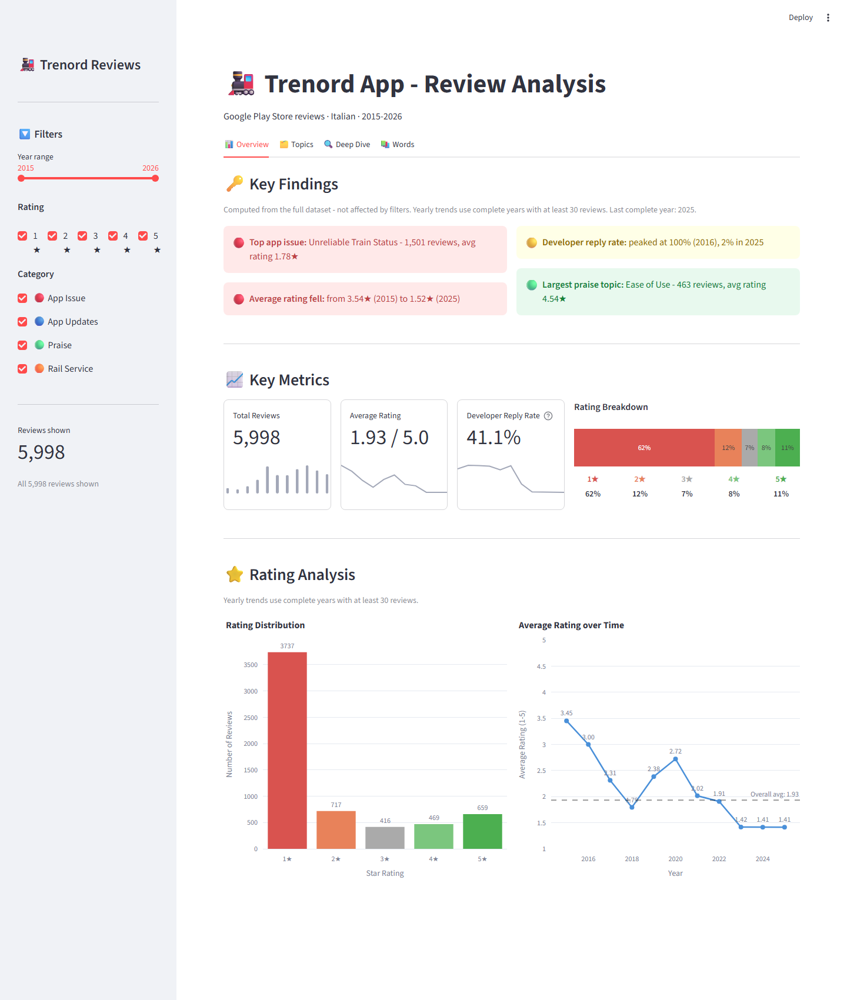

# Trenord App Reviews: Topic Modeling with BERTopic

[](https://github.com/paolotroia-datavizlab/trenord-reviews-bertopic/actions/workflows/tests.yml)

What do users complain about, and what do they appreciate, in the Trenord train app? This project collects
the app's public Google Play reviews, pseudonymizes them, groups the Italian reviews into topics with BERTopic,
and publishes the results in an interactive Streamlit dashboard.



- **Dashboard:** https://trenord-review-analysis.streamlit.app
- **Technical documentation:** [docs/architecture.md](docs/architecture.md)
- **Glossary:** [docs/glossary.md](docs/glossary.md)
- **Data dictionary:** [columns of the published CSVs](docs/architecture.md#14-data-dictionary)

## Key findings

- **Ratings have collapsed:** the yearly average of Italian reviews fell from 3.54★ in 2015 to 1.52★ in 2025.
- **Developer replies stopped:** Trenord answered 83-100% of reviews each year until 2020, and less than 4% since 2022.
- **Top app issues:** unreliable train status (1,501 reviews), ticket purchase failures (1,143) and subscription
  purchase failures (641).
- **Mostly complaints:** 84.9% of the 5,998 informative reviews fall in App Issue topics; 1.5% are about the rail
  service rather than the app.
- **What users like:** ease of use is the largest Praise topic (463 reviews, 4.54★).

## Tech stack

Python 3.13 · pandas · spaCy · lingua · BERTopic (sentence-transformers, UMAP, HDBSCAN) · matplotlib · Streamlit · Plotly

## Repository structure

```
.github/          GitHub Actions workflow that runs the tests
dashboard/        Streamlit app and its stopword list
data/processed/   published CSVs read by the dashboard
docs/             technical documentation and glossary
notebooks/        pipeline, run in this order:
  01_scraping.ipynb                    download the Play Store reviews
  01b_anonymization.ipynb              pseudonymize ids, drop author names
  02_cleaning.ipynb                    language detection, text cleaning, lemmas
  03_analysis.ipynb                    ratings and developer replies over time
  04a_model_selection.ipynb            compare BERTopic settings
  04b_topic_modeling_training.ipynb    train BERTopic
  04c_topic_modeling_analysis.ipynb    label the topics, export the dashboard files
reports/figures/  charts from the analysis and the dashboard screenshot
tests/            dashboard smoke tests (Streamlit AppTest)
```

## Quick start

```bash
python -m venv venv_trenord
venv_trenord\Scripts\activate        # macOS / Linux: source venv_trenord/bin/activate
pip install -r requirements.txt
streamlit run dashboard/app.py
```

To run the tests: `pip install pytest`, then `pytest tests/` from the repository root.

To run the notebooks, install their dependencies and create `.env` with your own pseudonymization key:

```bash
pip install -r requirements-notebooks.txt   # or requirements-notebooks.lock.txt for the full pinned environment
cp .env.example .env                        # then replace change_me with the output of:
python -c "import secrets; print(secrets.token_hex(32))"
```

Never commit `.env`. A different key gives different `review_id` values but identical topics and results. In the
environment of the lock file, training the topic model in 04b gives exactly the same topics. For the full pipeline,
see [Reproducibility in docs/architecture.md](docs/architecture.md#11-reproducibility).

## Data and privacy

Reviews come from an unofficial scraper and cover only part of the store's reviews (about 43% of its ratings).
Author names are removed, review ids are pseudonymized with a keyed hash, and the raw data is not published.
Details: [Privacy and data handling](docs/architecture.md#12-privacy-and-data-handling).

## License

The code is MIT-licensed ([LICENSE](LICENSE)); the license does not cover the review data, whose rights remain
with their authors and the platform.

## Author

Paolo Troia

- LinkedIn: [LINKEDIN_URL]
- Blog: [BLOG_URL]
