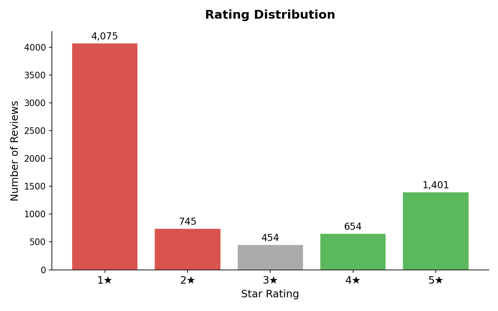
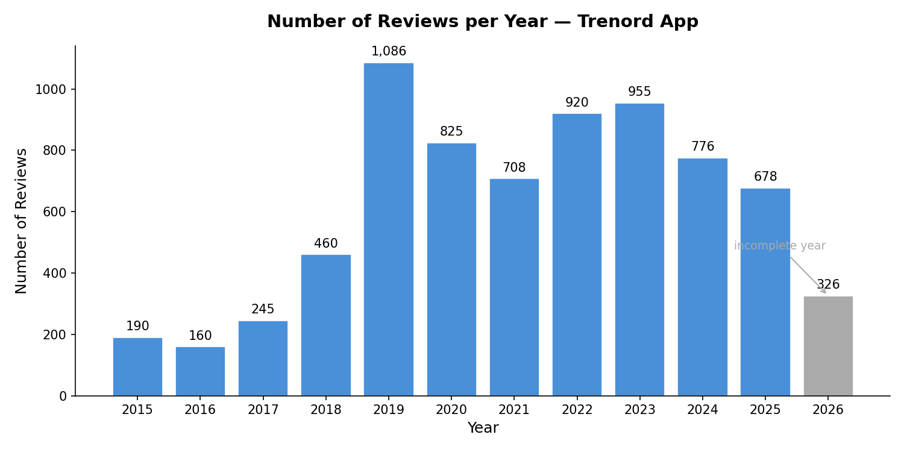
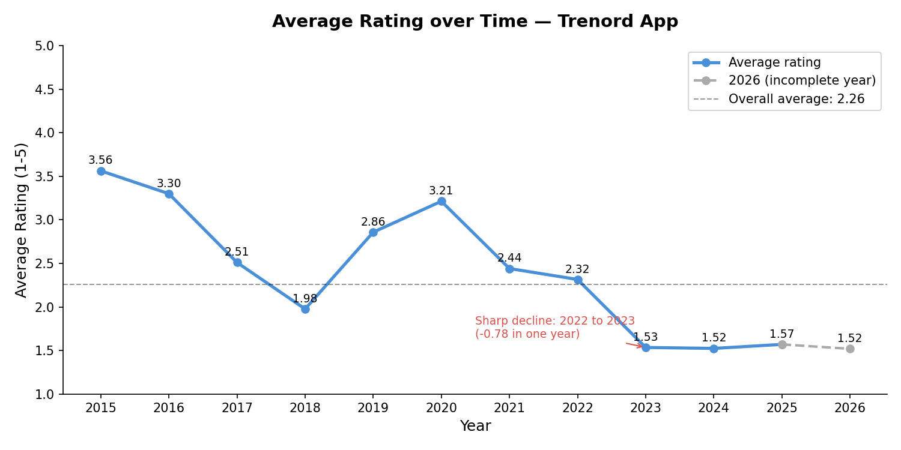
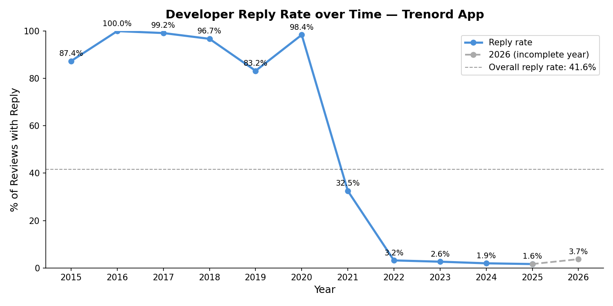
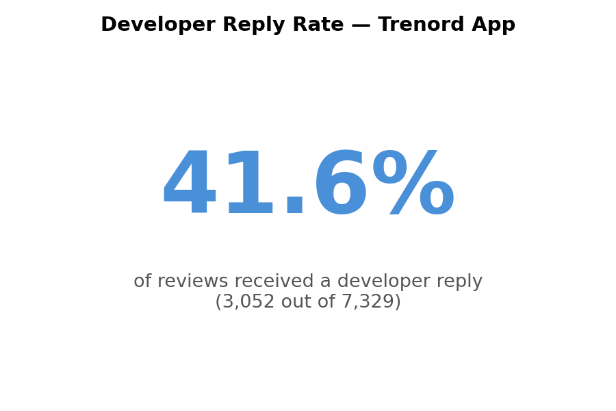
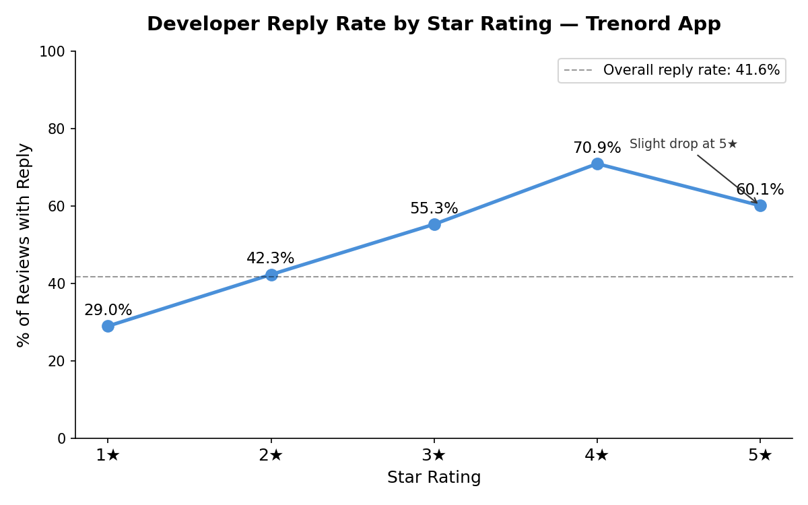

# Trenord App — Review Analysis

What do users complain about, and what do they appreciate, in the Trenord mobile app?
This project collects the public Google Play Store reviews of the Trenord app (`it.nordcom.app`),
pseudonymises them, explores ratings and developer replies over time, and groups the Italian
reviews into topics with BERTopic. The results are published in an interactive Streamlit dashboard.

**Dashboard:** https://trenord-review-analysis.streamlit.app
**Technical documentation:** [docs/architecture.md](docs/architecture.md)

## Key results

Values computed from the final data (latest review: 4 August 2026; complete years up to 2025).
Yearly averages and rates use only years with at least 30 reviews, the same threshold as the dashboard;
every year from 2015 to 2025 meets it.

- **7,329 reviews** collected, **6,951 in Italian**. Average rating of the Italian reviews: **2.17★**.
- **Ratings have collapsed.** The yearly average went from **3.54★ in 2015** to **1.52★ in 2025**.
  The sharpest recent drop came between 2022 and 2023, and the rating has stayed near 1.5★ since.
- **Developer replies stopped.** Trenord answered **83–100%** of Italian reviews every year from 2015 to 2020.
  The rate fell to **32% in 2021** and has been **below 4%** since 2022 (**1.7% in 2025**).
- **13 topics** describe 6,046 informative reviews. **84.5%** of them fall in Problem topics. The largest are:

| Topic | Category | Reviews | Share | Avg ★ |
|---|---|---:|---:|---:|
| Real-time Train Info | Problem | 1,530 | 25.3% | 1.78 |
| Ticket Purchase Failures | Problem | 1,119 | 18.5% | 1.41 |
| Subscription Issues | Problem | 654 | 10.8% | 1.44 |
| App Stability & Crashes | Problem | 635 | 10.5% | 1.58 |
| Poor Usability | Problem | 531 | 8.8% | 1.45 |
| Ease of Use | Praise | 500 | 8.3% | 4.53 |

  Ease of Use is also the largest Praise topic. The full table of the 13 topics is in [docs/architecture.md](docs/architecture.md#7-notebook-04b--topic-labeling-and-export)
  and in the dashboard.

### Charts (notebook 03, all reviews)

| | |
|---|---|
|  |  |
|  |  |
|  |  |

## Pipeline

| Step | What it does | Input | Output |
|---|---|---|---|
| `notebooks/01_scraping.ipynb` | Scrapes app metadata and reviews from Google Play | Google Play Store | `data/raw/trenord_reviews_raw.csv` (local only) |
| `notebooks/01b_anonymization.ipynb` | Pseudonymises `review_id` (keyed HMAC), drops `author`, masks ticket-like codes in the text | `data/raw/trenord_reviews_raw.csv` | `data/processed/trenord_reviews_anon.csv` (local only) |
| `notebooks/02_cleaning.ipynb` | Date features, language detection, text cleaning, lemmatization | `trenord_reviews_anon.csv` | `data/processed/trenord_reviews_clean.csv` (local only) |
| `notebooks/03_analysis.ipynb` | Exploratory analysis: ratings, volume, developer reply rate | `trenord_reviews_clean.csv` | six charts `data/processed/chart_*.png` |
| `notebooks/04a_topic_modeling_training.ipynb` | Trains BERTopic on the Italian reviews (**frozen**, do not retrain) | `trenord_reviews_clean.csv` | `trenord_reviews_topics.csv`, `bertopic_model/` (local only) |
| `notebooks/04b_topic_modeling_analysis.ipynb` | Applies the label map to the frozen topics, merges, bias check, export | `trenord_reviews_topics.csv`, `bertopic_model/` | `trenord_reviews_labeled.csv`, `trenord_reviews_analysis.csv`, `top_reviews_per_topic.csv`, `bertopic_model_final/` |
| `dashboard/app.py` | Streamlit dashboard (Overview, Topics, Deep Dive, Words) | the three CSVs from 04b | web app |

## Data and privacy

- **Source.** Reviews come from the unofficial [`google-play-scraper`](https://github.com/JoMingyu/google-play-scraper)
  library, not from an official API. Google Play exposes only part of the reviews to third parties.
  The dataset holds 7,329 reviews against 16,787 ratings shown on the store, about **43%** coverage.
  Ratings without text cannot be scraped at all.
- **Sampling.** Reviews are requested with `Sort.NEWEST` and paginated until the endpoint returns no more
  pages. The sample is therefore time-contiguous and reproducible, but it reflects what the endpoint serves.
  Older periods may be under-represented relative to the store total.
- **Raw data is not published.** `data/raw/` is gitignored. Notebook 01b is the only step that reads the raw file.
- **Pseudonymisation.** The `author` column is dropped. `review_id` is replaced by a keyed hash: HMAC-SHA256,
  truncated to 12 hexadecimal characters. The secret key (`PSEUDO_KEY`) lives in a local `.env` file, which is
  gitignored; `.env.example` documents the variable. Without the key, the original ids can be neither
  recovered nor recomputed.
- **Published files.** The repository includes the three CSVs read by the dashboard. They contain the review text,
  the rating and the developer's public reply (`reply_text`, kept exactly as published on the store).
  They contain no author names and no original review ids. Ticket-like codes in the review text are masked as `[CODE]`.

## Methodology

- **Topic model.** BERTopic with `paraphrase-multilingual-mpnet-base-v2` embeddings, UMAP (5 dimensions,
  cosine, `random_state=42`), HDBSCAN (`min_cluster_size=30`) and a CountVectorizer with Italian stopwords and
  bigrams. Topic keywords use Maximal Marginal Relevance (`diversity=0.3`). All outliers are reassigned to the
  closest topic by embedding similarity. The model found 30 topics, now frozen.
- **Labeling.** Each topic was reviewed manually (keywords, rating profile, representative and sampled reviews).
  Labels are assigned through a map keyed on the frozen topic ids. Topics that share a label are merged,
  giving 13 final topics.
- **Categories.** Following Maalej et al. (2016), every topic is a Problem, Feature Request, Praise or Other.
  No topic qualifies as Feature Request: requests are scattered across topics and dominate none of them.
- **Exclusion rule.** Topics made mostly of very short, generic sentiment ("ottima", "pessima",
  "non funziona") are excluded as noise. This affects 10 of the 30 topics: **905 reviews, 13.0%** of the Italian reviews.
- **Bias check.** Excluded reviews are much more positive than the included ones (**3.67★ vs 1.94★**).
  The analysis set is therefore more negative than all Italian reviews (2.17★), and topic-level results
  should be read with this in mind.

## How to run

```bash
# 1. Environment (Python 3.13, see .python-version)
python -m venv venv_trenord
venv_trenord\Scripts\activate          # Windows
# source venv_trenord/bin/activate     # macOS / Linux

pip install -r requirements-notebooks.txt   # notebooks
pip install -r requirements.txt             # dashboard

# 2. Secret key for pseudonymisation
cp .env.example .env                   # then set PSEUDO_KEY to a long random string

# 3. Notebooks, in order (from the notebooks/ folder)
#    01_scraping → 01b_anonymization → 02_cleaning → 03_analysis → 04b_topic_modeling_analysis
#    04a_topic_modeling_training only to retrain, which requires rebuilding the label map in 04b

# 4. Dashboard (from the repository root)
streamlit run dashboard/app.py
```

The pseudonymised ids depend on the key, so outputs are only reproducible with the same `.env`.

## Limitations

- Partial and non-random sample of the store reviews (about 43% coverage, `Sort.NEWEST`, unofficial scraper).
- Topic modeling covers Italian reviews only (6,951 of 7,329); 363 reviews have an undetermined language.
- Each review gets one topic, although many reviews mention several issues.
- Labels and the exclusion rule are manual judgements. Excluding generic reviews makes the analysis set more negative.
- The star rating is used as the sentiment signal; no separate sentiment model is applied.
- Topic 3 (Poor Usability) is a borderline topic with many short, generic complaints.

## Future work

- Aspect-based sentiment analysis, to capture several issues and opinions within one review.
- Analysis of the developer replies: content, response time, and effect on later ratings.

## License

The code is released under the [MIT License](LICENSE). The license covers the **code only**. It does not cover
the review data: the rights to the reviews remain with their authors and with the platform.
