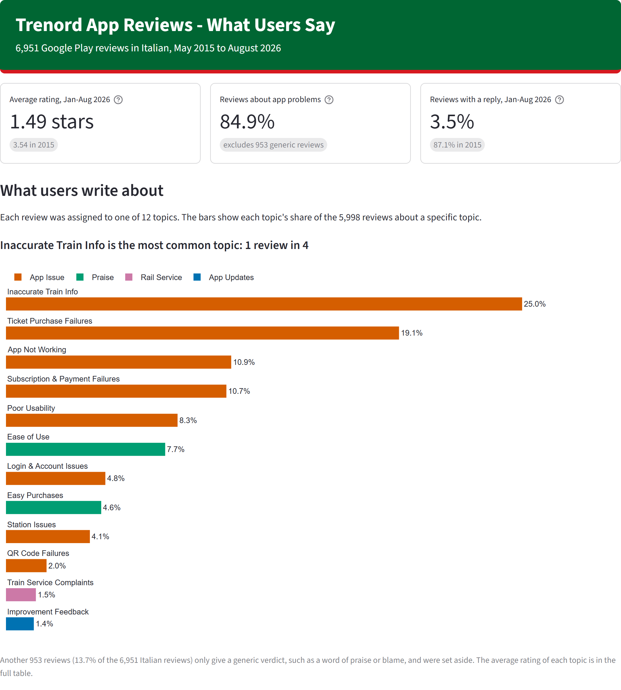
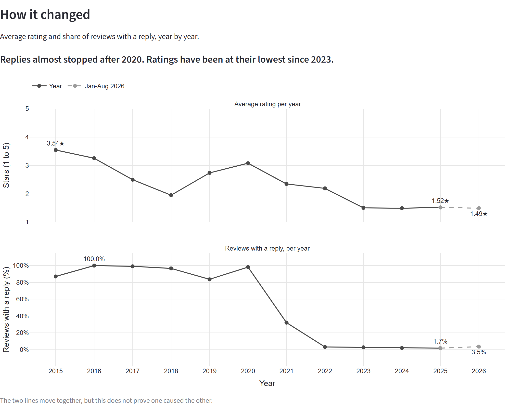

# Trenord App Reviews

What do people complain about in the Trenord app? I collected 6,951 Italian reviews from Google Play (May 2015 to August 2026), grouped them into topics with BERTopic and checked the topics by hand.

**Dashboard:** https://trenord-review-analysis.streamlit.app

## What I found

- The average rating fell from 3.54 stars in 2015 to 1.52 in 2025 (1.49 in Jan-Aug 2026).
- Trenord replied to 83-100% of reviews every year until 2020, and to less than 4% every year since 2022.
- 84.9% of the reviews about a specific topic describe a problem with the app. The most common are inaccurate train info (25.0%) and failed ticket purchases (19.1%).
- What users like most is ease of use (463 reviews, 4.54 stars).
- A blind manual check of 196 reviews agrees with the topics in 86.6% of cases (95% CI 81.7% to 91.2%).

 

## What Trenord could fix first

1. Train information, the largest topic.
2. Buying and using a ticket: tickets, subscriptions and QR codes are 31.7% of the reviews.
3. App stability, usability and login.
4. Replies to reviews.

And keep what users like: ease of use and easy purchases.

## How it works

Eight notebooks, run in order: scraping, anonymization, cleaning, exploratory analysis, model selection, training, labeling, validation. The choices and checks behind each step are in [docs/architecture.md](docs/architecture.md).

Python 3.13 · pandas · spaCy · BERTopic · Plotly · Streamlit

## Limits

- Google Play only, and the scraper reached about 43% of the store's ratings.
- Unhappy users write more, so the shares describe reviewers, not all users.
- 953 generic reviews ("great", "terrible") are left out of the topics.
- One person checked the labels.

## Data and license

Author names are removed and review ids are pseudonymized. The code is MIT-licensed. The review texts belong to their authors and are not covered by the license; to have a review removed, open an issue.

Paolo Troia · [LinkedIn](https://www.linkedin.com/in/paolotroia/)
