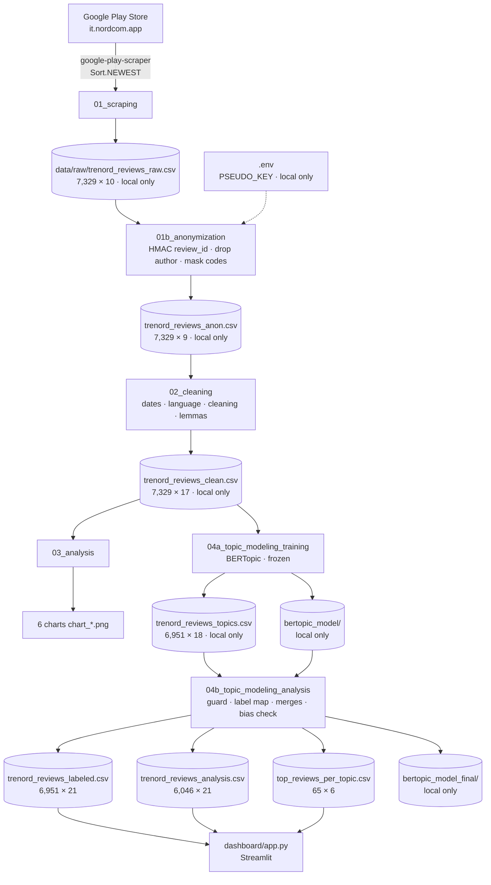

# Trenord App Review Analysis — Architecture and Methods

This document describes how the project is built and why. It is meant as a technical source for a
future article. Every parameter is copied from the code, and every number comes from the outputs of the
final pipeline run. The data snapshot is the scrape behind commit `9c0c3ec`; its latest review is dated
2026-08-04. The document contains no review texts and no author names.

---

## 1. Overview

### Goal and research question

The Trenord app (`it.nordcom.app`) is the official app of Lombardy's regional railway operator. It is used
to check train status, buy tickets and renew subscriptions. The project asks:

> **What do users of the Trenord app complain about and what do they appreciate, how has their satisfaction
> evolved over time, and how has the operator responded?**

The study uses the public reviews on the Google Play Store. Ratings and developer replies are analysed
over time. The Italian review texts are grouped into topics with BERTopic, and each topic is labeled and
classified with the review taxonomy of Maalej et al. (2016).

### Data flow

### Produced files

| File | Producer | Rows × columns | Published |
|---|---|---|---|
| `data/raw/trenord_reviews_raw.csv` | 01 | 7,329 × 10 | no (gitignored) |
| `data/processed/trenord_reviews_anon.csv` | 01b | 7,329 × 9 | no |
| `data/processed/trenord_reviews_clean.csv` | 02 | 7,329 × 17 | no |
| `data/processed/chart_*.png` (6 charts) | 03 | — | yes |
| `data/processed/trenord_reviews_topics.csv` | 04a | 6,951 × 18 | no |
| `data/processed/bertopic_model/` | 04a | 30 topics | no |
| `data/processed/trenord_reviews_labeled.csv` | 04b | 6,951 × 21 | yes |
| `data/processed/trenord_reviews_analysis.csv` | 04b | 6,046 × 21 | yes |
| `data/processed/top_reviews_per_topic.csv` | 04b | 65 × 6 | yes |
| `data/processed/bertopic_model_final/` | 04b | 23 topics | no |

All CSVs are written with `encoding="utf-8-sig"` and `index=False`.

---

## 2. Notebook 01 — Scraping

### Purpose
Download the app's public metadata and all the reviews that the Play Store endpoint serves, and save them
unchanged.

### Input and output
- Input: Google Play Store, through the unofficial `google-play-scraper` library (version 1.2.7).
- Output: `data/raw/trenord_reviews_raw.csv`, 7,329 rows × 10 columns:
  `review_id, author, rating, text, thumbs_up, app_version, date, has_reply, reply_text, reply_date`.

### Method
1. Configuration:
   `APP_ID = "it.nordcom.app"`, `LANGUAGE = "it"`, `COUNTRY = "it"`, `BATCH_SIZE = 200`, `MAX_REVIEWS = 16000`.
2. App metadata via `app(APP_ID, lang=LANGUAGE, country=COUNTRY)`. At scraping time: rating 1.82, 16,787 ratings,
   1,000,000+ installs, version 4.16.7.
3. Paginated download with
   `reviews(APP_ID, lang=LANGUAGE, country=COUNTRY, sort=Sort.NEWEST, count=min(BATCH_SIZE, remaining), continuation_token=continuation_token)`,
   with `time.sleep(0.5)` between pages. The loop stops when the target is reached, a page is empty,
   or the continuation token is `None`. Here it stopped after batch 38 because no more reviews were available.
4. Coverage: 7,329 collected reviews out of 16,787 store ratings, **43.7%**.
5. The fields `reviewId, userName, score, content, thumbsUpCount, appVersion, at, replyContent, repliedAt`
   are mapped to the 10 columns above. `has_reply` is derived as `replyContent is not None`.

### Design decisions and rationale
- **`Sort.NEWEST` instead of `Sort.MOST_RELEVANT`.** Newest-first pagination returns a time-contiguous
  sample whose ordering is well defined. "Most relevant" depends on an opaque ranking that changes over time.
- **Raw immutability.** The raw file is written once and is never modified by later steps. Notebook 01b only
  reads it and works on a copy.
- **`utf-8-sig`.** The byte-order mark lets Excel open the file with the correct encoding (accented Italian
  characters, emoji).
- `MAX_REVIEWS` is set above the store total, so in practice the endpoint's own limit decides the sample size.

### Validation
- Coverage computed and printed: 43.7%.
- The loop ended on the endpoint's "no more reviews" condition, not on the target.

### Known limitations
- Unofficial scraper: Google can change the endpoint, and the reviews it serves are a subset of the store total.
- Ratings without text are not retrievable, so coverage is measured against ratings and not against written reviews.
- Rerunning 01 produces a different snapshot and overwrites the raw file.

---

## 3. Notebook 01b — Anonymization

### Purpose
Pseudonymise the reviews before any further processing, so that no downstream notebook, dataset or the
dashboard handles direct identifiers.

### Input and output
- Input: `data/raw/trenord_reviews_raw.csv` (read only), plus `PSEUDO_KEY` from `.env`, which is located with
  `load_dotenv(find_dotenv(usecwd=True))`.
- Output: `data/processed/trenord_reviews_anon.csv`, 7,329 rows × 9 columns (the raw columns without `author`).

### Method
1. **Key check.** The notebook stops if `PSEUDO_KEY` is missing, empty or equal to the placeholder `change_me`.
2. **`review_id` → keyed hash.**
   `hmac.new(key_bytes, message_bytes, hashlib.sha256).hexdigest()[:12]`, so HMAC-SHA256 truncated to
   **12 hexadecimal characters (48 bits)**.
3. **Mask codes in `text`.** Mixed letter-and-digit strings of 8 or more characters are masked first, then runs
   of 8 or more digits; both become `[CODE]`:
   - `MIXED_CODE_PATTERN = r"\b(?=[A-Za-z0-9]*\d)(?=[A-Za-z0-9]*[A-Za-z])[A-Za-z0-9]{8,}\b"`
   - `DIGIT_CODE_PATTERN = r"(?<!\d)\d{8,}(?!\d)"`
4. **Drop `author`.**
5. **`reply_text`** (the developer's public reply) is kept exactly as in the raw file.

### Design decisions and rationale
- **Keyed HMAC instead of a plain hash.** A plain SHA-256 of a review id is deterministic and keyless. Anyone
  who knows an original id, which is public on the store, could recompute the hash and re-identify the row.
  With HMAC the mapping stays stable across runs, which keeps outputs reproducible, but it can be neither
  inverted nor recomputed without the secret key.
- **12 hex characters** keep about 7,000 ids unique, with a negligible collision probability; uniqueness is
  checked explicitly.
- **Single point of contact with raw data.** Only 01b reads the raw file. Every later step starts from the
  anonymised file.

### Validation (results of the final run)

| Check | Result |
|---|---|
| Same row count as raw | PASS (7,329 / 7,329) |
| `author` column absent | PASS |
| `review_id` unique | PASS (7,329 unique) |
| No original `review_id` present | PASS |
| `reply_text` identical to raw for every row | PASS (0 rows different; 3,052 non-null replies in both) |
| `[CODE]` replacements in `text` | 5 |

The notebook raises an error and does not save the output if any check fails.

### Known limitations
- Free text can still contain personal information written by the reviewers themselves. Only ticket-like codes are masked.
- `reply_text` is published unchanged and can address the reviewer by first name, as the public reply on the store does.
- Pseudonymised ids are reproducible only with the same key.

---

## 4. Notebook 02 — Cleaning

### Purpose
Enrich and normalise the anonymised reviews for analysis and topic modeling.

### Input and output
- Input: `data/processed/trenord_reviews_anon.csv` (7,329 × 9).
- Output: `data/processed/trenord_reviews_clean.csv`, 7,329 rows × 17 columns. The added columns are
  `year, month, day_of_week, year_month, language, text_clean, word_count, text_lemmatized`.

### Method
1. **Date features** from `date`: `year`, `month`, `day_of_week`, `year_month`. Date range: 2015-05-05 to 2026-08-04.
2. **Language detection** with `lingua` (`LanguageDetectorBuilder.from_all_languages().build()`), with a two-level rule:
   - if the top language is Italian, it is accepted at any confidence;
   - any other language requires `CONFIDENCE_THRESHOLD = 0.5`, otherwise the review is labeled `unknown`.
3. **Text cleaning** into `text_clean`: lowercase, remove URLs (`http\S+|www\.\S+`), replace every character
   outside `[a-zàèéìíòóùú\s]` with a space, collapse whitespace.
4. **Word count** on the original text (`len(str(x).split())`).
5. **Lemmatization** with spaCy `it_core_news_lg` into `text_lemmatized`. A token's lemma is kept if
   `token.is_alpha` holds, `not token.is_stop` holds and `len(token.lemma_) > 2`.

### Design decisions and rationale
- **Two-level language detection.** Inspection showed that very short Italian reviews ("pessima", "ottima")
  are recognised as Italian but with low confidence. A single threshold would have discarded them, while
  accepting other languages at low confidence would have introduced noise.
- **Two text versions.** `text_clean` keeps natural word order for transformer embeddings (04a).
  `text_lemmatized` groups word variants for frequency-based analyses (dashboard Words tab).

### Validation (results of the final run)

| Measure | Value |
|---|---|
| Language distribution | it 6,951 · unknown 363 · en 5 · la 5 · fr 2 · es 1 · mi 1 · pt 1 |
| Empty after cleaning | 10 |
| Empty after lemmatization | 135 |
| Average words per review (original text) | 19.9 |

None of the 10 empty cleaned texts is among the Italian reviews used for topic modeling.

### Known limitations
- Non-Italian reviews (378) are not analysed further.
- The character filter removes digits and emoji, so information such as "10 minutes late" loses the number.

---

## 5. Notebook 03 — Exploratory analysis

### Purpose
Describe ratings, review volume and developer replies over the whole dataset (all languages).

### Input and output
- Input: `data/processed/trenord_reviews_clean.csv` (7,329 × 17).
- Output: six charts in `data/processed/`: `chart_rating_distribution.png`, `chart_reviews_per_year.png`,
  `chart_avg_rating_over_time.png`, `chart_reply_rate_overall.png`, `chart_reply_rate_by_rating.png`,
  `chart_reply_rate_over_time.png` (saved with `dpi=150`).

### Method and results
1. **Overview.** 7,329 reviews; average rating 2.26; median 1.0; 3,052 reviews with a reply (41.6%);
   20 words per review on average.
2. **Rating distribution.** 1★ 4,075 · 2★ 745 · 3★ 454 · 4★ 654 · 5★ 1,401.
3. **Reviews per year.** The peak is in 2019 (1,086 reviews); 2026 is incomplete (326 reviews).
4. **Average rating over time** (line chart, y axis fixed at 1–5). From 3.56 in 2015 to 1.57 in 2025.
   The chart annotates the most recent yearly drop of at least 0.5★, computed from the data:
   2022 → 2023, −0.78.
5. **Developer reply rate.** By rating it rises from 29.0% (1★) to 70.9% (4★) and falls to 60.1% at 5★.
   Over time it stays between 83% and 100% from 2015 to 2020, falls to 32.5% in 2021, and stays below 4% from 2022.
6. **Most upvoted reviews.** Displayed as metadata only (upvotes, rating, date, length); the texts are not shown.

### Design decisions and rationale
- Line charts for averages and rates (bars would suggest a zero baseline); the y axis covers the full 1–5 scale.
- The incomplete year is drawn in grey and dashed, so it is not read as a real decline.

### Validation
The charts are regenerated at every run from the data; no number in the charts is hardcoded.

### Known limitations
- This notebook uses all languages; the topic analysis uses Italian only. Values therefore differ slightly from
  the dashboard (e.g. average rating 2.26 here vs 2.17 for Italian reviews).
- The co-occurrence of reply collapse and rating decline is descriptive, not causal.

---

## 6. Notebook 04a — Topic model training

### Purpose
Train the BERTopic model on the Italian reviews and save it as the **frozen** model used by 04b.

### Input and output
- Input: `data/processed/trenord_reviews_clean.csv`, filtered to `language == "it"` (6,951 reviews).
- Output:
  - `data/processed/trenord_reviews_topics.csv`: 6,951 × 18, the clean columns plus `topic`.
  - `data/processed/bertopic_model/`: saved with `serialization="safetensors"`, `save_ctfidf=True`,
    `save_embedding_model="paraphrase-multilingual-mpnet-base-v2"`.

### Method (parameters verbatim)
1. **Texts.** `text_clean`; empty or missing texts are replaced by `" "` (0 in this run).
2. **Embeddings.** `SentenceTransformer("paraphrase-multilingual-mpnet-base-v2")`.
3. **UMAP.** `UMAP(n_neighbors=15, n_components=5, min_dist=0.0, metric="cosine", random_state=42)`.
4. **HDBSCAN.** `HDBSCAN(min_cluster_size=30, metric="euclidean", prediction_data=True)`.
5. **CountVectorizer.** `CountVectorizer(stop_words=list(italian_stopwords), min_df=5, ngram_range=(1, 2))`,
   with the spaCy Italian stopwords.
6. **Representation.** `MaximalMarginalRelevance(diversity=0.3)`.
7. **BERTopic.** `top_n_words=10, language="multilingual", calculate_probabilities=False`.
8. **Training.** `fit_transform(texts)` produced 30 topics and 1,609 outliers (topic −1).
9. **Outlier reduction.** `reduce_outliers(texts, topics, strategy="embeddings", threshold=0.0)` assigned all
   outliers to their closest topic, leaving 0 outliers.
10. **Representation update.** `update_topics(texts, topics=new_topics, vectorizer_model=vectorizer_model, representation_model=representation_model)`.

### Design decisions and rationale
- **`text_clean` rather than `text_lemmatized`.** Transformer embeddings are trained on natural text;
  lemmatized, stopword-free text loses the context they rely on.
- **`random_state=42` in UMAP** makes the result reproducible.
- **`threshold=0.0` in outlier reduction.** The outliers were inspected and judged to be valid reviews, so every
  review receives a topic; noise is handled afterwards by the exclusion rule in 04b.
- **MMR** reduces redundant keywords (e.g. singular and plural forms of the same word).
- **Frozen model.** Labeling (04b) depends on the topic ids. The model is trained once, and 04b checks that it is
  unchanged before applying any label.

### Validation
- 30 topics; topic sizes between 43 and 1,119 reviews; 0 outliers after reduction.
- **Reproducibility check (2026-11-01).** The notebook was rerun after the anonymization change and compared
  with a backup of the frozen model, matching rows on `review_id`. Result: 0 of 6,951 rows with a different topic,
  identical number and sizes of topics, and identical top-10 keywords and weights for all 30 topics. The only
  file-level difference was the order of the 624 stopwords stored in the vectorizer configuration, because spaCy
  stores them as a set.

### Known limitations
- One topic per review, although many reviews mention several issues.
- Reproducibility was verified on one machine with the pinned library versions; other hardware or versions may
  change the result.
- Some topics are dominated by short generic reviews (see the exclusion rule in 04b).

---

## 7. Notebook 04b — Topic labeling and export

### Purpose
Apply the manual labeling to the frozen topics, merge topics that share a label, check the bias introduced by
the exclusions, and export the datasets used by the dashboard.

### Input and output
- Input: `trenord_reviews_topics.csv` (6,951 × 18) and `bertopic_model/`. `trenord_reviews_clean.csv` is used
  only for the `reply_text` check.
- Output:
  - `trenord_reviews_labeled.csv`: 6,951 × 21 (adds `topic_label`, `category`, `topic_merged`).
  - `trenord_reviews_analysis.csv`: 6,046 × 21 (EXCLUDE removed).
  - `top_reviews_per_topic.csv`: 65 × 6 (`topic_label, category, rating, thumbs_up, date, text`), the 5 most
    upvoted reviews with at least one upvote, for each of the 13 topics.
  - `bertopic_model_final/`: the model after the merges, 23 topics.

### Method
1. **Guard.** The notebook checks that the topic ids in `topics.csv` and in the model are exactly 0–29, that the
   sizes in both match a hardcoded `expected_sizes` dictionary, and that the model assignments match `topics.csv`
   row by row. Any failure raises an error explaining that the model changed and the label map must be rebuilt.
2. **Label map keyed on frozen ids.** A list `LABEL_GROUPS` of `(ids, label, category)`. An assertion checks that
   every id 0–29 appears exactly once.
3. **Merges.** `TOPICS_TO_MERGE = [[2, 4, 8, 28], [5, 16], [7, 23], [6, 9], [13, 19]]`. An assertion checks that the
   list equals the multi-topic groups of the label map. The MMR representation (`diversity=0.3`) is restored, and
   `merge_topics(texts, TOPICS_TO_MERGE)` is run only to update the keywords and topic embeddings of the saved model.
4. **Consistency.** Every post-merge topic contains reviews of a single label, and every kept label corresponds to
   a single post-merge topic.
5. **Distribution, bias check, export and output checks.**

### Final topics

| Label | Category | Frozen ids | Reviews | Share | Avg ★ |
|---|---|---|---:|---:|---:|
| Real-time Train Info | Problem | 2, 4, 8, 28 | 1,530 | 25.3% | 1.78 |
| Ticket Purchase Failures | Problem | 0 | 1,119 | 18.5% | 1.41 |
| Subscription Issues | Problem | 1 | 654 | 10.8% | 1.44 |
| App Stability & Crashes | Problem | 5, 16 | 635 | 10.5% | 1.58 |
| Poor Usability | Problem | 3 | 531 | 8.8% | 1.45 |
| Ease of Use | Praise | 6, 9 | 500 | 8.3% | 4.53 |
| Login & Account | Problem | 7, 23 | 291 | 4.8% | 1.39 |
| Purchase & Payment Praise | Praise | 13, 19 | 269 | 4.4% | 4.01 |
| Station & Favorites Bugs | Problem | 11 | 164 | 2.7% | 1.74 |
| QR Code at Turnstiles | Problem | 14 | 117 | 1.9% | 1.60 |
| Trenord Service Complaints | Other | 22 | 86 | 1.4% | 1.14 |
| Version Evolution | Other | 20 | 84 | 1.4% | 3.65 |
| Station Coverage Gaps | Problem | 27 | 66 | 1.1% | 1.80 |

By category: Problem 5,107 (84.5%) · Praise 769 (12.7%) · Other 170 (2.8%) · Feature Request 0.
Excluded topics: frozen ids 10, 12, 15, 17, 18, 21, 24, 25, 26, 29, for a total of 905 reviews (13.0% of the
Italian reviews).

### Design decisions and rationale
- **Label map keyed on frozen ids.** `merge_topics()` renumbers all topics by size. The previous version of 04b
  keyed its labels on post-merge ids of an earlier model; after the model was retrained, those labels pointed to
  the wrong topics without any error. Keying on frozen ids, combined with the guard, turns that silent failure
  into an explicit error.
- **Categories (Maalej et al., 2016).** Problem: something does not work or no longer works. Feature Request:
  functionality users ask to be added. Praise: what users appreciate. Other: not about the app itself, or
  comparisons between versions.
- **Exclusion rule.** A topic is excluded when it consists mostly of very short reviews (about five words or
  fewer) that express generic sentiment without saying what works or fails. Such reviews add the rating but no
  information about the app.
- **Topic 3 kept as Poor Usability.** It is borderline: its reviews are short and many are generic. It is
  nevertheless the only topic that collects complaints about clarity, intuitiveness, complexity and slowness.
  Excluding it would remove the usability dimension and make the excluded set even more positive.
- **Station Coverage Gaps as Problem.** The reviews report stations removed from the app or missing from its
  station list, often after an update: a regression, not a request for new functionality.
- **No Feature Request topic.** Requests are scattered across topics and dominate none of them.
- **Text inspection is kept out of the notebook.** The manual review notes contain review texts and stay local
  (`labeling/`, gitignored). The notebook prints only counts and aggregates.

### Validation (results of the final run)

| Check | Result |
|---|---|
| Guard: ids 0–29 in topics.csv and model; sizes match expected; assignments match row by row | 5 × PASS |
| Every id 0–29 exactly once in the label map | PASS (30 ids, 13 labels + EXCLUDE) |
| Merge list equals the multi-topic groups of the label map | PASS |
| Post-merge topics | 23; each maps to exactly one label, and each kept label to one post-merge topic |
| No `author` column in any output | PASS |
| `review_id` hashed (12 hex) for every row | PASS (6,951 / 6,951) |
| `reply_text` identical to clean.csv (and thus to raw) | PASS (0 different) |
| 13 labels in analysis.csv, no EXCLUDE rows | PASS |
| Frozen model files unchanged by 04b | verified by SHA-256 |

**Bias check.** Excluded reviews have an average rating of 3.67 (68.2% are 4–5★); included reviews, 1.94 (19.1% are
4–5★); all Italian reviews, 2.17. The conclusion is computed in the notebook: excluded reviews are more positive,
so the analysis set is more negative than all Italian reviews.

### Known limitations
- The labels and the exclusion rule are manual judgements.
- The analysis set is more negative than the full dataset (see the bias check).
- Poor Usability includes many short, generic complaints.

---

## 8. Dashboard

### Data files read
All three paths are built from `Path(__file__).parent.parent / "data" / "processed"`.
- `trenord_reviews_analysis.csv`: informative reviews, used by most views and by the filters.
- `trenord_reviews_labeled.csv`: all Italian reviews, used for the reply rate and the rating trend in Key Findings.
- `top_reviews_per_topic.csv`: the most upvoted reviews per topic, shown in Deep Dive.
- `dashboard/stopwords_it.txt`: a static copy of the 624 spaCy Italian stopwords, so the app does not depend on spaCy.

### Filters (sidebar)
A year range slider; one checkbox per star rating; one checkbox per category. The categories are read from the
data, so the Feature Request filter disappears because no topic has that category. Unchecking every rating or
every category falls back to all of them. When the filters return no rows, each tab shows an information message
instead of failing.

### Incomplete year and minimum yearly sample
The last complete year is derived from the latest review date: the year of that date if it is 31 December,
otherwise the year before (here 2025). All yearly trends and sparklines use complete years only.

Yearly averages and rates are computed only for years with at least `MIN_REVIEWS_PER_YEAR = 30` reviews in the
data being plotted. This applies to:
- the rating and reply-rate trends, and their peaks in Key Findings;
- the reply-rate chart;
- the rating and reply sparklines;
- the per-topic rating trend in the priority table, where each topic-year must have at least 30 reviews.

The threshold is stated in a caption next to each of these elements. Yearly review counts are shown for every
complete year. For all Italian reviews every year from 2015 to 2025 meets the threshold (minimum 154 reviews),
so the Key Findings are unaffected. For the smallest topics, some or all topic-years fall below it.

### Tabs
1. **Overview.**
   - Key Findings, computed at every run and not affected by the filters:
     - top problem: the Problem topic with the most reviews, with its average rating;
     - average rating in the first vs the last complete year with at least 30 reviews (all Italian reviews);
     - peak developer reply rate vs the rate in the last such year (all Italian reviews);
     - largest Praise topic, with its size and average rating.
   - KPI cards with sparklines (reviews and average rating follow the filters; the reply rate uses all Italian
     reviews, as its help text states).
   - Rating breakdown, rating distribution, and average rating over time.
2. **Topics.**
   - Key findings that follow the filters: most critical Problem topic, share of Problem reviews, most discussed
     topic, best-rated topic.
   - Topic priority table with average rating, review count, yearly rating trend and reply rate.
   - Developer reply rate over time, all Italian reviews; the incomplete year is dashed.
3. **Deep Dive.** For one selected topic: category badge; KPI cards with sparklines (average rating vs the
   filtered average, share of reviews, reply rate, all following the filters); rating distribution; rating trend;
   the most upvoted reviews.
4. **Words.** Most frequent lemmas in 1–2★ reviews (bar chart and word cloud), and "critical words" ranked by a
   normalized frequency ratio:
   `score = (freq_neg / n_neg) / (freq_pos / n_pos + 0.001)`, keeping only words with at least 10 negative
   mentions. A yearly trend chart shows the top 5.

### Key Findings at this snapshot
- Top problem: Real-time Train Info, 1,530 reviews, average rating 1.78★.
- Average rating fell from 3.54★ (2015) to 1.52★ (2025).
- Developer reply rate peaked at 100% (2016) and was 2% in 2025.
- Largest praise topic: Ease of Use, 500 reviews, average rating 4.53★.

### Design decisions
- **Normalized frequency ratio instead of differential TF-IDF.** The score is the per-review rate of a word in
  negative reviews divided by its rate in positive reviews. It reads directly as "x times more frequent in
  negative reviews", corrects for the very different number of negative and positive reviews, and needs only a
  small smoothing constant.
- Shared helpers render the rating distribution, the rating trend and the reply-rate charts, and shared
  constants define the colours and category styles.

### Validation
A smoke test with `streamlit.testing.v1.AppTest` ran 18 scenarios without exceptions and with all 4 tabs rendered:
- default filters;
- each of the 13 Deep Dive topics;
- zero rows (2015, 1★, Other);
- only the incomplete year 2026;
- Praise only (no Problem topics);
- 5★ only (no negative reviews).

---

## 9. Reproducibility

**Run order.** 01 → 01b → 02 → 03 → 04a → 04b → dashboard. In normal use, 01 and 04a are **not** rerun:
01 would produce a new snapshot, and 04a would produce a new model.

**Environment.** Python 3.13.0 (`.python-version`). Notebook dependencies are pinned in
`requirements-notebooks.txt`, dashboard dependencies in `requirements.txt`, and the secret key lives in `.env`
(template: `.env.example`).

**Deterministic steps.**
- 01b, given the same raw file and key: the HMAC is deterministic.
- 02: lingua and spaCy are deterministic for fixed versions.
- 03.
- 04b: it loads the frozen model, and its outputs were reproduced identically in consecutive runs.
- 04a: verified once to be reproducible on the same machine (see §6).

**Non-deterministic or external steps.**
- 01 depends on the live store.
- 04a may differ across hardware or library versions.

**Why 04a must not be retrained without rebuilding the label map.** The label map in 04b refers to the topic ids
and sizes of the frozen model. A retrained model can number and size its topics differently. Labels would then be
attached to the wrong reviews, which is exactly what happened before the label map was keyed on frozen ids.
The guard in 04b now stops with an error in that case.

---

## 10. Privacy and data handling

| Item | Status |
|---|---|
| Raw reviews (`data/raw/`) | local only, gitignored |
| `trenord_reviews_anon.csv`, `trenord_reviews_clean.csv`, `trenord_reviews_topics.csv` | local only, gitignored |
| BERTopic models | local only, gitignored |
| Manual labeling notes (`labeling/`, contain review texts) | local only, gitignored |
| Secret key (`.env`) | local only, gitignored; `.env.example` holds a placeholder |
| `labeled.csv`, `analysis.csv`, `top_reviews_per_topic.csv` | published (dashboard data): review text, rating, date, app version, developer reply; no author, pseudonymised id |
| Charts | published (aggregates only) |

**Pseudonymisation.**
- `review_id` is replaced by `HMAC-SHA256(PSEUDO_KEY, review_id)` truncated to 12 hex characters.
- Without the key, an original id cannot be mapped to its pseudonym, so published rows cannot be joined back to
  store records by id.
- The author's display name is dropped in 01b and never reaches a downstream file.
- Ticket-like codes in the review text are masked.

**Notebook outputs.** The notebooks print only counts and aggregates: no review texts, names or keys appear in
any saved notebook output.

---

## 11. Decision log

In chronological order. Dates are those of the commits that introduced each step; discarded alternatives are in
italics.

1. **2026-05-05 — Scraping with `Sort.NEWEST`.** It gives a time-contiguous, well-defined sample.
   *`Sort.MOST_RELEVANT` was not used: its ranking is opaque and changes over time.*
   The raw file is immutable and written with `utf-8-sig`.
2. **2026-05-07 — Two-level language detection with lingua.** Italian is accepted at any confidence, other
   languages at 0.5 or above. *A single confidence threshold would have discarded many short Italian reviews.*
3. **2026-05-07 — Two text versions.** `text_clean` for embeddings, `text_lemmatized` for frequency analyses.
4. **Design phase (no dated commit) — No separate sentiment analysis.** The star rating is used as the sentiment signal, because it
   is available for every review and expressed by the author.
   *A sentiment classifier was considered unnecessary given the rating.*
5. **2026-05-09/10 — BERTopic pipeline, split into 04a (training) and 04b (labeling).** The model is trained once
   and saved in safetensors format. *An earlier single notebook with 19 final topics was replaced.*
6. **2026-05-14 — Dashboard** with four tabs, deployed on Streamlit Cloud. Critical words use a normalized
   frequency ratio. *Differential TF-IDF was not used, being less directly interpretable.*
7. **2026-09-01 — Rescrape** to 7,329 reviews and retraining of the topic model (30 topics). This exposed the
   weakness of labels keyed on post-merge ids, which no longer matched the new model.
8. **2026-11-01 — Anonymization step 01b.** Keyed HMAC for `review_id`, `author` dropped, codes masked.
   *A plain hash was rejected because it can be recomputed from the public id.*
   *Removing reviewer names from `reply_text` was implemented and then dropped;* the reply is kept identical to
   the published text, which is verified row by row. The topic model was retrained to check the effect, and the
   result was identical (§6).
9. **2026-11-01 — Relabeling of the frozen model.**
   - Label map keyed on frozen ids, with a guard.
   - 13 final topics; 10 topics excluded by the exclusion rule.
   - **Delay Notifications merged into Real-time Train Info**: topics 8 and 28 describe the same problem as 2 and 4.
   - **Digital Payments reclassified as Praise**: topic 19 is mostly positive reviews of Satispay and PayPal,
     merged with topic 13 into Purchase & Payment Praise. *Previously a Feature Request.*
   - **Station Coverage Gaps classified as Problem**: stations removed or missing, a regression.
     *Feature Request was considered.*
   - **Topic 3 kept as Poor Usability** despite being borderline. *Exclusion was considered.*
   - **Topics 6 and 9 merged into Ease of Use.**
   - As a result, no topic is a Feature Request.
10. **2026-11-01 — Dashboard and repository cleanup.**
    - Key Findings and the incomplete-year cutoff are computed from the data.
    - Yearly averages and rates require at least 30 reviews per year.
    - The "most discussed topic" card, which duplicated "top problem", is replaced by the largest Praise topic.
    - Category filters are built from the data; empty filter results are handled.
    - Dependencies are split into `requirements.txt` (dashboard) and `requirements-notebooks.txt` (notebooks).
    - The spaCy dependency is replaced in the dashboard by a static stopword list.
