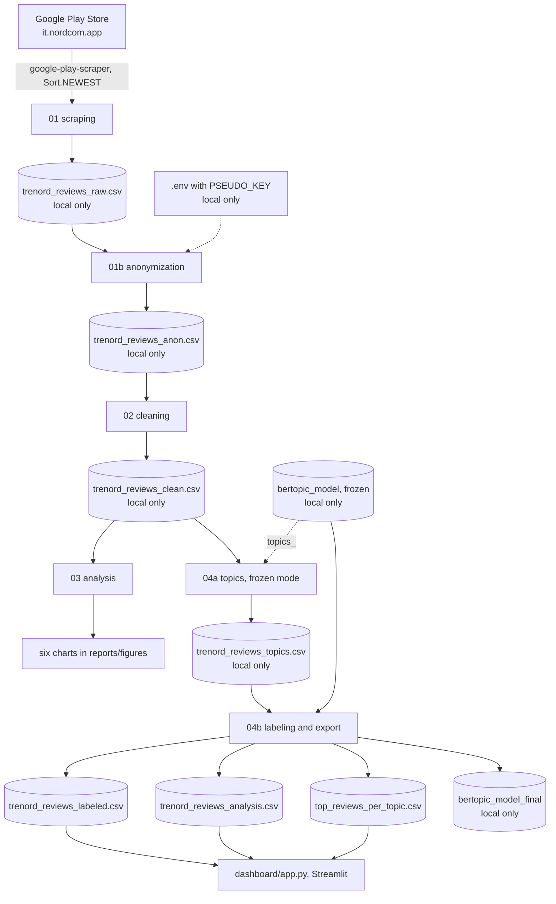

# Trenord App Reviews: Topic Modeling with BERTopic

This document explains how the project is built and why. It is a study guide to read side by side with the
notebooks, and a technical source for a future article.

- Parameters are copied from the code; numbers come from the final pipeline run.
- The data snapshot is the scrape whose latest review is dated 2026-08-04.
- No review texts or author names appear here.
- Technical terms link to [glossary.md](glossary.md) the first time they appear.

**Cell numbers** count every cell of a notebook from the top, markdown cells included, starting at 1.

---

## 1. Overview

### Goal and research question

The Trenord app (`it.nordcom.app`) is the official app of Lombardy's regional railway operator. It is used to check
train status, buy tickets and renew subscriptions. The project asks:

> **What do users of the Trenord app complain about and what do they appreciate, how has their satisfaction
> evolved over time, and how has the operator responded?**

The study uses the public Google Play Store reviews:
- ratings and developer replies are analysed over time;
- the Italian review texts are grouped into topics with [BERTopic](glossary.md#bertopic);
- each topic is labeled and classified with the [Maalej taxonomy](glossary.md#maalej-taxonomy).

### Data flow



### Produced files

All files are in `data/processed/` unless stated otherwise. Row counts are in [Key numbers](#2-key-numbers).

| File | Producer | Published |
|---|---|---|
| `data/raw/trenord_reviews_raw.csv` | 01 | no (gitignored) |
| `trenord_reviews_anon.csv` | 01b | no |
| `trenord_reviews_clean.csv` | 02 | no |
| `reports/figures/chart_*.png` (6 charts) | 03 | yes |
| `reports/figures/dashboard_overview.png` (dashboard screenshot) | — | yes |
| `trenord_reviews_topics.csv` | 04a | no |
| `bertopic_model/` (frozen; rewritten only with `RETRAIN = True`) | 04a | no |
| `trenord_reviews_labeled.csv`, `trenord_reviews_analysis.csv`, `top_reviews_per_topic.csv` | 04b | yes |
| `bertopic_model_final/` | 04b | no |

All CSVs are written with `encoding="utf-8-sig"` and `index=False`.

---

## 2. Key numbers

This table is the single source of numbers for the article. **All languages** figures come from notebook 03.
**Italian only** figures cover the topic analysis and the dashboard. Yearly figures use complete years
(up to 2025).

### Data and coverage

| Measure | Value |
|---|---|
| Store ratings at scraping time / reviews collected | 16,787 / 7,329 (coverage **43.7%**) |
| Raw → anon → clean (rows × columns) | 7,329 × 10 → 7,329 × 9 → 7,329 × 17 |
| Language split | Italian 6,951 · unknown 363 · other languages 15 |
| Topics file / labeled / analysis / top reviews | 6,951 × 18 / 6,951 × 21 / 6,046 × 21 / 65 × 6 |

### Ratings and replies

| Measure | All languages (03) | Italian only (dashboard) |
|---|---|---|
| Reviews | 7,329 | 6,951 |
| Average rating | **2.26** | **2.17** |
| Average rating, first → last complete year | 3.56 (2015) → 1.57 (2025) | 3.54 (2015) → 1.52 (2025) |
| Developer reply rate, overall | 41.6% (3,052 reviews) | 41.1% |
| Reply rate 2015–2020 | 83–100% each year | 83–100% each year (peak 100%, 2016) |
| Reply rate 2021 → 2025 | 32.5% → 1.6% (below 4% every year from 2022) | 32.1% → 1.7% (below 4% every year from 2022) |

### Topics

| Measure | Value |
|---|---|
| Topics found by the model | 30 (1,609 [outliers](glossary.md#outlier) reassigned) |
| Topics after [merging](glossary.md#topic-merge) / final labels | 23 / 13 |
| Excluded | 10 topics, 905 reviews (**13.0%** of Italian reviews) |
| Analysis set | 6,046 reviews |
| Category split | Problem 5,107 (84.5%) · Praise 769 (12.7%) · Other 170 (2.8%) · Feature Request 0 |
| Bias check: average rating | excluded 3.67 · included 1.94 · all Italian 2.17 |
| Bias check: share of 4–5★ | excluded 68.2% · included 19.1% |

---

## 3. Notebook 01 — Scraping

**In plain words.** This notebook downloads the public reviews of the Trenord app from the Google Play Store and
saves them in a file, exactly as received. Nothing is changed at this stage, so every later step can be traced back
to the original data.

### Input and output
- Input: Google Play Store, through the unofficial `google-play-scraper` library (version 1.2.7).
- Output: `data/raw/trenord_reviews_raw.csv` with the columns
  `review_id, author, rating, text, thumbs_up, app_version, date, has_reply, reply_text, reply_date`.

### Method
1. Set the configuration: `APP_ID = "it.nordcom.app"`, `LANGUAGE = "it"`, `COUNTRY = "it"`, `BATCH_SIZE = 200`,
   `MAX_REVIEWS = 16000` (cell 3).
2. Fetch the app metadata with `app(APP_ID, lang=LANGUAGE, country=COUNTRY)`. At scraping time the app had a
   1.82 rating, 1,000,000+ installs and version 4.16.7 (cell 4).
3. Download page by page with
   `reviews(APP_ID, lang=LANGUAGE, country=COUNTRY, sort=Sort.NEWEST, count=min(BATCH_SIZE, remaining), continuation_token=continuation_token)`,
   pausing `time.sleep(0.5)` between pages. The [continuation token](glossary.md#continuation-token) links the
   pages. The loop stops when the target is reached, a page is empty or the token is `None`; here it stopped after
   batch 38, when no more reviews were available (cell 5).
4. Compute coverage against the store's rating count (cell 6).
5. Map `reviewId, userName, score, content, thumbsUpCount, appVersion, at, replyContent, repliedAt` to the ten
   columns; `has_reply` is `replyContent is not None` (cell 8).
6. Save the raw file (cell 9).

### Parameters

| Parameter | Value | Why |
|---|---|---|
| `sort` | `Sort.NEWEST` | Time-contiguous sample with a well-defined order. |
| `BATCH_SIZE` | 200 | Largest page size the library supports reliably (notebook comment). |
| `MAX_REVIEWS` | 16000 | Set by hand, well above the 7,329 reviews the endpoint actually served, so in practice the endpoint's own limit decided the sample size. |

### Design decisions
- **Newest first, not "most relevant".** `Sort.MOST_RELEVANT` was rejected: its ranking is opaque and changes over time.
- **Raw immutability.** The raw file is written once and never modified. Only 01b reads it, and it works on a copy.
- **`utf-8-sig`.** The [BOM](glossary.md#bom-byte-order-mark) lets Excel read accented characters and emoji correctly.

### Validation
- Coverage is computed and printed.
- The loop ended on the endpoint's "no more reviews" condition, not on the target.
- The outputs saved in notebook 01 come from the scrape behind the current data snapshot. The notebook is not rerun,
  because that would rescrape; the dataframe cell (cell 8) has no saved output because it was edited after that run.

### Known limitations
- The scraper is unofficial: the endpoint can change, and it serves only a subset of the store's reviews.
- The sample reflects what the endpoint serves, so older periods may be under-represented relative to the store total.
- Ratings without text cannot be retrieved, so coverage is measured against ratings, not written reviews.
- Rerunning 01 produces a new snapshot and overwrites the raw file.

---

## 4. Notebook 01b — Anonymization

**In plain words.** This notebook removes the reviewers' names and replaces each review's original identifier with
a code that cannot be traced back without a secret key. It is the only step that touches the original file, so
everything after it works on protected data.

### Input and output
- Input: the raw file (read only), plus the [secret key](glossary.md#secret-key) `PSEUDO_KEY` from `.env`.
- Output: `trenord_reviews_anon.csv`, with the raw columns minus `author`.

### The secret key
- **Generation.** 64 hexadecimal characters (256 random bits), generated in the project venv with
  `python -c "import secrets; print(secrets.token_hex(32))"`.
- **Storage.** Only in `.env` at the repository root, which is gitignored. `.env.example` is the tracked template:
  it explains the variable and holds the placeholder `change_me`.
- **Loading.** `find_dotenv(usecwd=True)` searches for `.env` from the working directory (`notebooks/`) upwards, and
  `load_dotenv()` adds its variables to the environment, where `os.getenv("PSEUDO_KEY")` reads them.
- **Key check.** The notebook stops before hashing if the key is missing, empty or still `change_me`: ids hashed
  with a known key could be recomputed by anyone from the public store ids.
- **Rotation.** The key was rotated on 2026-11-02 and the pipeline rerun (§10). Every published `review_id` changed;
  nothing else did.

### Method
1. Load the key and the raw file, and run the key check. The key is encoded to bytes once, as `KEY_BYTES`, instead
   of at every call of `pseudonymize_id` (cell 2).
2. Replace `review_id` with an [HMAC](glossary.md#hmac):
   `hmac.new(KEY_BYTES, message_bytes, hashlib.sha256).hexdigest()[:12]` (cell 3).
3. Mask ticket-like codes in `text` as `[CODE]`: first mixed letter-and-digit strings of 8 or more characters,
   then runs of 8 or more digits (cell 4).
   - `MIXED_CODE_PATTERN = r"\b(?=[A-Za-z0-9]*\d)(?=[A-Za-z0-9]*[A-Za-z])[A-Za-z0-9]{8,}\b"`
   - `DIGIT_CODE_PATTERN = r"(?<!\d)\d{8,}(?!\d)"`
4. Drop `author` (cell 5).
5. Run the checks; the output is saved only if all of them pass (cells 6–7).
6. Preview the first rows of `review_id, rating, thumbs_up, app_version, date, has_reply` (cell 8). Text and reply
   columns are left out because notebook outputs are published.

`reply_text`, the developer's public reply, is kept exactly as in the raw file.

### Parameters

| Parameter | Value | Why |
|---|---|---|
| Hash | HMAC-SHA256 | Keyed: stable across runs with the same key, but not recomputable without it. |
| Key | 64 hex characters (`secrets.token_hex(32)`) | 256 random bits from Python's cryptographically secure generator. |
| Truncation | 12 hex characters (48 bits) | Short, yet the chance of any collision among ~7,300 ids is about 1 in 10 million (notebook comment); uniqueness is also checked. |
| Code length | 8+ characters | Typical length of ticket, order and card numbers; set by hand, not tuned. |

### Design decisions
- **Keyed HMAC instead of a plain hash.** A plain SHA-256 of a public review id can be recomputed by anyone who knows
  the id, which would re-identify the row. This is the core of the [pseudonymization](glossary.md#pseudonymization).
- **Single point of contact with raw data.** Every later step starts from the anonymised file.
- **Reply text left intact.** An earlier version also removed reviewer names from `reply_text`. That step was
  dropped: the reply is kept identical to the text published on the store, and this is verified row by row.

### Validation (final run, after the key rotation)

| Check | Result |
|---|---|
| Same row count as raw | PASS |
| `author` column absent | PASS |
| `review_id` unique | PASS |
| No original `review_id` present | PASS |
| `reply_text` identical to raw for every row | PASS (0 rows different; 3,052 non-null replies in both) |
| `[CODE]` replacements in `text` | 5 |
| Compared with the run before the rotation | every `review_id` different, no id shared; all other columns identical |

### Known limitations
- Reviewers may write personal information in the text; only ticket-like codes are masked.
- `reply_text` is published unchanged, so it can greet the reviewer by first name, as on the store.
- Pseudonymised ids can be reproduced only with the same key. Ids made with different keys cannot be joined.

---

## 5. Notebook 02 — Cleaning

**In plain words.** This notebook prepares the reviews for analysis. It works out the language of each review,
removes symbols and links from the text, and reduces words to their basic form, so that "bought" and "buying"
count as the same word.

### Input and output
- Input: `trenord_reviews_anon.csv`.
- Output:
  - `trenord_reviews_clean.csv`, which adds
    `year, month, day_of_week, year_month, language, text_clean, word_count, text_lemmatized`;
  - `dashboard/stopwords_it.txt`, the stopword list used by the dashboard.

### Method
1. Load the anonymised file (cell 2).
2. Derive date features from `date`. The range is 2015-05-05 to 2026-08-04 (cell 3).
3. Detect the language with `lingua` (`LanguageDetectorBuilder.from_all_languages().build()`) (cell 4):
   - Italian as the top language is accepted at any [confidence](glossary.md#language-detection-confidence);
   - any other language needs `CONFIDENCE_THRESHOLD = 0.5`, otherwise the review is labeled `unknown`.
4. Clean the text into `text_clean`: lowercase, remove URLs (`http\S+|www\.\S+`), replace characters outside
   `[a-zàèéìíòóùú\s]` with spaces, collapse whitespace. Count words on the original text (cell 5).
5. [Lemmatize](glossary.md#lemmatization) with spaCy `it_core_news_lg` into `text_lemmatized`. A token is kept if it
   is alphabetic, is not one of the [stopwords](glossary.md#stopwords) and has a lemma longer than 2 characters (cell 6).
6. Export spaCy's Italian `STOP_WORDS` to `dashboard/stopwords_it.txt`: a header comment, then one word per line,
   sorted, UTF-8 (cell 7).
7. Save (cell 8).

### Parameters

| Parameter | Value | Why |
|---|---|---|
| Italian acceptance | any confidence | Inspection found 921 short Italian reviews ("pessima", "ottima") detected as Italian with low confidence. |
| `CONFIDENCE_THRESHOLD` (other languages) | 0.5 | A conventional midpoint between accepting and rejecting; not tuned. |
| Minimum lemma length | > 2 characters | Removes very short words ("va", "fa") with little meaning; set by hand. |

### Design decisions
- **Two-level language detection.** A single threshold was rejected: a strict one discards short Italian reviews,
  and a loose one admits other languages at low confidence.
- **Two text versions.** `text_clean` keeps natural word order for the [embeddings](glossary.md#embedding) (04a); `text_lemmatized` groups
  word variants for frequency analyses (dashboard).

### Validation (final run)
- The language split is in Key numbers.
- 10 reviews are empty after cleaning, none of them Italian.
- 135 reviews are empty after lemmatization.
- The original text has 19.9 words per review on average.

### Known limitations
- The 378 non-Italian or undetermined reviews are not analysed further.
- The character filter removes digits and emoji, so "10 minutes late" loses the number.

---

## 6. Notebook 03 — Exploratory analysis

**In plain words.** This notebook describes the reviews as a whole: how many stars people give, how this changed
over the years, and how often the company answered. It produces six charts.

### Input and output
- Input: `trenord_reviews_clean.csv` (all languages).
- Output: six charts in `reports/figures/`, saved with `dpi=150`:
  - `chart_rating_distribution.png`
  - `chart_reviews_per_year.png`
  - `chart_avg_rating_over_time.png`
  - `chart_reply_rate_overall.png`
  - `chart_reply_rate_by_rating.png`
  - `chart_reply_rate_over_time.png`

### Method and results
Overall figures are in Key numbers (all languages column).
1. Overview: median rating 1.0, 20 words per review on average (cell 3).
2. Rating distribution: 1★ 4,075 · 2★ 745 · 3★ 454 · 4★ 654 · 5★ 1,401 (cell 5).
3. Reviews per year: the peak is in 2019 (1,086 reviews); 2026 is incomplete (326 reviews) (cell 6).
4. Average rating over time, with the y axis fixed at 1–5. The chart annotates the most recent yearly drop of at
   least 0.5★, computed from the data: 2022 → 2023, −0.78 (cell 7).
5. Reply rate overall (cell 9) and by rating: it rises from 29.0% (1★) to 70.9% (4★), then falls to 60.1% at 5★
   (cell 10).
6. Reply rate over time; the yearly values are in Key numbers (cell 11).
7. Most upvoted reviews, shown as metadata only: upvotes, rating, date, length (cell 13).

### Design decisions
- **Line charts for averages and rates.** Bars would suggest a zero baseline. The y axis covers the full 1–5 scale.
- **Incomplete year in grey and dashed**, so it is not read as a real decline.
- **The star rating is the sentiment signal.** It is available for every review and given by the author. A separate
  sentiment classifier was considered unnecessary.

### Validation
The charts are regenerated from the data at every run; no number in them is hardcoded.

### Known limitations
- This notebook covers all languages, while the topic analysis covers Italian only, so values differ slightly
  (see the two columns in Key numbers).
- That the reply collapse and the rating decline happen together is a description, not a proof of cause.

---

## 7. Notebook 04a — Topic model training

**In plain words.** This notebook reads the Italian reviews and lets an algorithm group together the reviews that
talk about similar things, without being told the themes in advance. The result was saved once and is kept
unchanged, because the human labels given to each group later depend on it. Normally the notebook does not train
again: it reads the saved model and writes out the group of each review.

### Input and output
- Input: `trenord_reviews_clean.csv`, filtered to `language == "it"`; in frozen mode also `bertopic_model/`.
- Output:
  - `trenord_reviews_topics.csv`: the clean columns plus `topic`.
  - `bertopic_model/`, only when retraining: saved with `serialization="safetensors"`, `save_ctfidf=True`,
    `save_embedding_model="paraphrase-multilingual-mpnet-base-v2"` ([safetensors](glossary.md#safetensors)).

### Modes: the `RETRAIN` flag
The first code cell sets `RETRAIN = False`.
- **Frozen mode (`RETRAIN = False`, default).** Cells 2–4 and 9 run; the training cells 5–8 print "Skipped".
  - Cell 4 loads the [frozen model](glossary.md#frozen-model) with `BERTopic.load(..., embedding_model=...)`.
  - It takes the topic stored for each training document (`topic_model.topics_`, in training order).
  - It checks that there are as many assignments as Italian rows, and attaches them to `italian_df`. The Italian
    rows have the same filter and order as in training.
  - Cell 9 writes `topics.csv` and leaves `bertopic_model/` untouched.
  - `review_id` is not a model input, so a new [secret key](glossary.md#secret-key) does not change any topic.
- **Retraining (`RETRAIN = True`).** Cells 5–8 run the training below, and cell 9 overwrites the frozen model.
  Cells 4 and 9 print a warning that the label map in 04b must be rebuilt. Retraining is environment-sensitive
  (see Validation), so it is only for a new labeling.

### Method (parameters verbatim; cells 5–8 run only when retraining)
1. Load the data and keep the Italian reviews (cell 2).
2. Prepare the `text_clean` texts. Empty or missing texts are replaced by `" "`; there were none in this run (cell 3).
3. Configure the model (cell 5):
   - embeddings from the [sentence transformer](glossary.md#sentence-transformer)
     `SentenceTransformer("paraphrase-multilingual-mpnet-base-v2")`;
   - [UMAP](glossary.md#umap): `UMAP(n_neighbors=15, n_components=5, min_dist=0.0, metric="cosine", random_state=42)`;
   - [HDBSCAN](glossary.md#hdbscan): `HDBSCAN(min_cluster_size=30, metric="euclidean", prediction_data=True)`;
   - [CountVectorizer](glossary.md#countvectorizer):
     `CountVectorizer(stop_words=list(italian_stopwords), min_df=5, ngram_range=(1, 2))`, with spaCy's Italian stopwords;
   - [MMR](glossary.md#mmr-maximal-marginal-relevance): `MaximalMarginalRelevance(diversity=0.3)`;
   - BERTopic: `top_n_words=10, language="multilingual", calculate_probabilities=False`.
4. Train with `fit_transform(texts)`: 30 topics and 1,609 outliers, which get topic −1 (cell 6).
5. [Reduce outliers](glossary.md#outlier-reduction) with
   `reduce_outliers(texts, topics, strategy="embeddings", threshold=0.0)`, leaving 0 outliers (cell 7).
6. Update the [topic representations](glossary.md#topic-representation), with [c-TF-IDF](glossary.md#c-tf-idf) keywords:
   `update_topics(texts, topics=new_topics, vectorizer_model=vectorizer_model, representation_model=representation_model)` (cell 8).
7. Save the topic assignments, and the model when retraining (cell 9).

The figures in steps 4–5 come from the original training run.

### Parameters

| Parameter | Value | Why |
|---|---|---|
| Embedding model | `paraphrase-multilingual-mpnet-base-v2` | "Best lightweight multilingual model that runs on CPU and handles Italian well" (notebook comment); not compared with alternatives. |
| UMAP `n_neighbors` | 15 | BERTopic's default UMAP setting; not tuned. |
| UMAP `n_components` | 5 | BERTopic's default; reduces dimensions before clustering. Not tuned. |
| UMAP `min_dist` | 0.0 | BERTopic's default; packs similar points tightly, which helps clustering. Not tuned. |
| UMAP `metric` | cosine | BERTopic's default; the usual choice for text embeddings. |
| UMAP `random_state` | 42 | Fixed [random seed](glossary.md#random-seed): "without it results change every run" (notebook comment). |
| HDBSCAN `min_cluster_size` | 30 | Set by hand: "a topic needs at least 30 reviews to be valid" (notebook comment). BERTopic's default is 10. No systematic tuning was done. |
| CountVectorizer `min_df` | 5 | Set by hand: a keyword must appear in at least 5 reviews (the library default is 1). Not tuned. |
| CountVectorizer `ngram_range` | (1, 2) | Single words plus [bigrams](glossary.md#bigram); a common choice for BERTopic keywords. Not tuned. |
| MMR `diversity` | 0.3 | "The value recommended in the official BERTopic documentation" (notebook comment). The library default is 0.1. |
| `top_n_words` | 10 | BERTopic's default. |
| `reduce_outliers` strategy / threshold | embeddings / 0.0 | Outliers were inspected and judged valid reviews, so all are reassigned by [cosine similarity](glossary.md#cosine-similarity). 0 is the library default threshold; the strategy was chosen over the default `distributions`. |

### Design decisions
- **`text_clean`, not `text_lemmatized`.** Transformer embeddings are trained on natural text. Lemmatized,
  stopword-free text was rejected because it loses the context they rely on.
- **Reassign every outlier.** Noise is handled afterwards by the exclusion rule in 04b, not by leaving reviews
  without a topic.
- **MMR** reduces redundant keywords, such as the singular and plural of the same word.
- **Training separated from labeling.** An earlier single notebook (19 final topics) was replaced by 04a
  (training) and 04b (labeling). The model is trained once and becomes a [frozen model](glossary.md#frozen-model).
- **Frozen mode by default.** Retraining gave a different clustering after the environment changed (below), so the
  notebook rebuilds `topics.csv` from the stored assignments instead of retraining. This keeps the 04b label map
  valid whatever the environment.

### Validation
- 30 topics, with sizes from 43 to 1,119 reviews; 0 outliers after reduction.
- **Retraining in the same environment (2026-11-01).** After the anonymization change, the notebook was retrained in
  the environment where the model had been trained. It was compared with a backup of the frozen model, matching
  rows on `review_id`:
  - 0 of 6,951 rows changed topic;
  - the number and sizes of the topics were identical;
  - the top-10 keywords and their weights were identical for all 30 topics.

  The only difference between files was the order of the 624 stopwords stored in the vectorizer configuration,
  because spaCy stores them as a set.
- **Retraining after the venv was rebuilt (2026-11-02).** After the project folder was renamed, the virtual
  environment was rebuilt from the same `requirements-notebooks.txt`. The notebook was retrained with the same code
  and data, and compared with the frozen model row by row (ids had changed with the key rotation):
  - 6,428 of 6,951 rows had a different topic id;
  - 92.1% of rows agreed under the best matching between old and new topics;
  - the adjusted Rand index was 0.81;
  - there were still 30 topics, but with different sizes (the largest 1,214 and 1,143, against 1,119 and 686) and
    different keywords.

  The packages installed in the original environment were not recorded, so the exact cause cannot be identified.
  The most likely cause is the indirect dependencies, which `requirements-notebooks.txt` does not pin, such as
  transformers, numba and pynndescent. The new run was discarded and the frozen model restored.
- **Frozen mode (2026-11-02).** `topics.csv` rebuilt from the frozen model: `topic` identical to the restored file
  for every row, and every other column identical except `review_id`. The model files were unchanged (SHA-256).

### Known limitations
- Each review gets one topic, although many mention several issues.
- Retraining is reproducible only in the same environment. The [lock file](glossary.md#lock-file) records today's
  environment, not the one in which the frozen model was trained.
- Some topics are dominated by short, generic reviews (see the exclusion rule in 04b).

---

## 8. Notebook 04b — Topic labeling and export

**In plain words.** This notebook gives each group of reviews a short human name and a category (problem, praise
or other), and sets aside groups made of very short reviews that say nothing specific. It then saves the files used
by the dashboard and checks that no personal data has slipped through.

### Input and output
- Input: `trenord_reviews_topics.csv` and `bertopic_model/`. `trenord_reviews_clean.csv` is used only to check
  `reply_text`.
- Output:
  - `trenord_reviews_labeled.csv`: adds `topic_label`, `category`, `topic_merged`.
  - `trenord_reviews_analysis.csv`: EXCLUDE rows removed.
  - `top_reviews_per_topic.csv` (`topic_label, category, rating, thumbs_up, date, text`): the 5 most upvoted reviews
    with at least one upvote, for each of the 13 topics.
  - `bertopic_model_final/`: the model after the merges.

### Method
1. Load the data and the frozen model, and run the **guard** (cell 3):
   - topic ids in `topics.csv` and in the model must be exactly 0–29;
   - sizes in both must match a hardcoded `expected_sizes`;
   - model assignments must match `topics.csv` row by row.

   Any failure raises an error explaining that the model changed and the label map must be rebuilt.
2. Document the labeling decisions in the notebook (cell 4).
3. Build the label map `LABEL_GROUPS` of `(ids, label, category)`, keyed on frozen ids; an assertion checks that
   every id 0–29 appears exactly once (cell 5).
4. Merge topics with `TOPICS_TO_MERGE = [[2, 4, 8, 28], [5, 16], [7, 23], [6, 9], [13, 19]]`.
   The list must equal the multi-topic groups of the label map. MMR (`diversity=0.3`) is restored, and
   `merge_topics(texts, TOPICS_TO_MERGE)` updates the keywords and embeddings of the saved model only. Every
   post-merge topic must hold a single label, and every kept label a single post-merge topic (cell 6).
5. Print the final distribution (cell 7) and run the bias check (cell 8).
6. Save the outputs (cell 9) and check them (cell 10).

### Final topics

| Label | Category | Frozen ids | Reviews | Share | Avg ★ |
|---|---|---|---:|---:|---:|
| Real-time Train Info | Problem | 2, 4, 8, 28 | 1,530 | 25.3% | 1.78 |
| Ticket Purchase Failures | Problem | 0 | 1,119 | 18.5% | 1.41 |
| Subscription Issues | Problem | 1 | 654 | 10.8% | 1.44 |
| App Stability & Crashes | Problem | 5, 16 | 635 | 10.5% | 1.58 |
| Poor Usability | Problem | 3 | 531 | 8.8% | 1.45 |
| Ease of Use | Praise | 6, 9 | 500 | 8.3% | 4.53 |
| Login & Account | Problem | 7, 23 | 291 | 4.8% | 1.39 |
| Purchase & Payment Praise | Praise | 13, 19 | 269 | 4.4% | 4.01 |
| Station & Favorites Bugs | Problem | 11 | 164 | 2.7% | 1.74 |
| QR Code at Turnstiles | Problem | 14 | 117 | 1.9% | 1.60 |
| Trenord Service Complaints | Other | 22 | 86 | 1.4% | 1.14 |
| Version Evolution | Other | 20 | 84 | 1.4% | 3.65 |
| Station Coverage Gaps | Problem | 27 | 66 | 1.1% | 1.80 |

Excluded frozen ids: 10, 12, 15, 17, 18, 21, 24, 25, 26, 29. Category and exclusion totals are in Key numbers.

### Design decisions
- **Label map keyed on frozen ids.** `merge_topics()` renumbers all topics by size.
  - The previous 04b keyed its labels on post-merge ids of an earlier model. After the 2026-09-01 rescrape and
    retraining, those labels pointed to the wrong topics without any error.
  - Frozen ids plus the guard turn that silent failure into an explicit error.
- **Categories.** Following the Maalej taxonomy:
  - Problem: something does not work, or no longer works;
  - Feature Request: functionality users ask to be added;
  - Praise: what users appreciate;
  - Other: not about the app itself, or comparisons between versions.
- **Exclusion rule.** A topic is excluded when it consists mostly of very short reviews (about five words or fewer)
  with generic sentiment and no indication of what works or fails.
- **Topic 3 kept as Poor Usability.** It is borderline: its reviews are short, and many are generic. Exclusion was
  considered. It is kept because it is the only topic about clarity, intuitiveness, complexity and slowness;
  excluding it would remove that dimension and make the excluded set even more positive.
- **Station Coverage Gaps is a Problem.** The reviews report stations removed from the app or missing from its list,
  often after an update. This is a regression, so Feature Request was rejected.
- **Delay Notifications merged into Real-time Train Info.** Topics 8 and 28 (late or wrong delay information) were
  once a separate topic, but they describe the same problem as topics 2 and 4.
- **Digital Payments reclassified as Praise.** Topic 19, formerly a Feature Request, is mostly positive reviews of
  the Satispay and PayPal options. It is merged with topic 13 into Purchase & Payment Praise.
- **Topics 6 and 9 merged into Ease of Use.**
- **No Feature Request topic.** Requests are scattered across topics and dominate none of them.
- **Text inspection kept out of the notebook.** The manual review notes contain review texts and stay local
  (`labeling/`, gitignored). The notebook prints only counts and aggregates.

### Validation (final run)

| Check | Result |
|---|---|
| Guard (ids 0–29 in both, sizes match, assignments match row by row) | 5 × PASS |
| Every id 0–29 exactly once in the label map | PASS (30 ids, 13 labels + EXCLUDE) |
| Merge list equals the multi-topic groups of the label map | PASS |
| Post-merge topics | 23; each maps to one label, and each kept label to one post-merge topic |
| No `author` column in any output | PASS |
| `review_id` hashed (12 hex) for every row | PASS (6,951 / 6,951) |
| `reply_text` identical to clean.csv (and thus to raw) | PASS (0 different) |
| 13 labels in analysis.csv, no EXCLUDE rows | PASS |
| Frozen model files unchanged by 04b | verified by SHA-256 |

**Bias check.** The values are in Key numbers. The notebook computes its conclusion from them: excluded reviews are
more positive, so the analysis set is more negative than all Italian reviews. This is an
[exclusion bias](glossary.md#exclusion-bias).

### Known limitations
- The labels and the exclusion rule are manual judgements.
- The analysis set is more negative than the full dataset.
- Poor Usability includes many short, generic complaints.

---

## 9. Dashboard

**In plain words.** The dashboard is a web page that shows the results interactively. Readers can filter by year,
star rating and category, look at one theme in detail, and see which words appear most in negative reviews.

### Data files read
Paths are built from `Path(__file__).parent.parent / "data" / "processed"`.
- `trenord_reviews_analysis.csv`: informative reviews, used by most views and by the filters.
- `trenord_reviews_labeled.csv`: all Italian reviews, used for reply rates and rating trends.
- `top_reviews_per_topic.csv`: shown in Deep Dive.
- `dashboard/stopwords_it.txt`: the 624 Italian stopwords of spaCy 3.8.14, exported by notebook 02 (§5).
  - **Regenerate:** rerun notebook 02, which rewrites the file. The app skips lines starting with `#`.
  - **Why a static export:** lightweight stopword libraries have different Italian lists, which would make the
    Words tab inconsistent with the notebooks. The export keeps the dashboard on the pipeline's exact list without
    installing spaCy.

### Filters
- Sidebar filters: a year range slider, one checkbox per star rating and one per category.
- Categories are read from the data, so there is no Feature Request filter.
- Unchecking every rating or every category falls back to all of them.
- When the filters return no rows, each tab shows an information message.

### Incomplete year and minimum yearly sample
- **Last complete year.** It is the year of the latest review if that review is dated 31 December, otherwise the
  year before (here 2025).
- **Minimum yearly sample.** Yearly averages and rates use only complete years with at least
  `MIN_REVIEWS_PER_YEAR = 30` reviews in the data being plotted. This applies to:
  - the trends and peaks in Key Findings;
  - the reply-rate chart;
  - the rating and reply [sparklines](glossary.md#sparkline);
  - the per-topic trend in the priority table, where each topic-year needs at least 30 reviews.
- The threshold is stated in a caption next to each of these. Yearly counts are shown for every complete year.
- For all Italian reviews every year from 2015 to 2025 meets the threshold (minimum 154 reviews), so Key Findings
  are unaffected. For the smallest topics, some or all topic-years fall below it.

### Parameters

| Parameter | Value | Why |
|---|---|---|
| `MIN_REVIEWS_PER_YEAR` | 30 | So that peaks and trends are not driven by a handful of reviews; a common rule-of-thumb sample size, not tuned. |
| Critical words: minimum negative mentions | 10 | Filters out rare words; set by hand. |
| Critical words: smoothing constant | 0.001 | Prevents division by zero for words absent from positive reviews; set by hand. |

### Tabs
1. **Overview.**
   - Key Findings, computed at every run and not affected by the filters:
     - top problem: the Problem topic with the most reviews, with its average rating;
     - average rating in the first vs the last qualifying year (Italian reviews);
     - peak reply rate vs the rate in the last qualifying year (Italian reviews);
     - largest Praise topic, with size and average rating.
   - KPI cards with sparklines. Review count and average rating follow the filters; the reply rate covers all
     Italian reviews, as its help text says.
   - Rating breakdown, rating distribution and average rating over time.
2. **Topics.**
   - Key findings that follow the filters: most critical Problem topic, share of Problem reviews, most discussed
     topic, best-rated topic.
   - A priority table with average rating, review count, yearly rating trend and reply rate.
   - The reply rate over time for all Italian reviews.
3. **Deep Dive.** For one topic:
   - its category badge;
   - KPI cards with sparklines, all following the filters;
   - rating distribution and rating trend;
   - its most upvoted reviews.
4. **Words.**
   - Most frequent lemmas in 1–2★ reviews, as a bar chart and a word cloud.
   - Critical words ranked by a [normalized frequency ratio](glossary.md#normalized-frequency-ratio),
     `score = (freq_neg / n_neg) / (freq_pos / n_pos + 0.001)`, with a yearly trend for the top 5.

### Key Findings at this snapshot
- **Top problem:** Real-time Train Info (1,530 reviews, 1.78★).
- **Average rating:** fell from 3.54★ (2015) to 1.52★ (2025).
- **Reply rate:** peaked at 100% (2016); 2% in 2025.
- **Largest Praise topic:** Ease of Use (500 reviews, 4.53★).

### Design decisions
- **Normalized frequency ratio instead of differential TF-IDF.** The score reads directly as "x times more frequent
  in negative reviews". It corrects for the different number of negative and positive reviews, and needs only a
  small smoothing constant. Differential TF-IDF was rejected as less interpretable.
- **Everything shown is computed from the data.** This covers the Key Findings, the incomplete-year cutoff and the
  category filters. A "most discussed topic" card was replaced by the largest Praise topic, because it duplicated
  "top problem".
- **No spaCy at runtime.** A static stopword list replaces the spaCy import, so the deployed app has fewer
  dependencies.
- **Shared code.** Helpers draw the rating distribution, rating trend and reply-rate charts; shared constants define
  colours and category styles.

### Validation
A [smoke test](glossary.md#smoke-test) with `streamlit.testing.v1.AppTest` ran 18 scenarios with no exceptions and
all 4 tabs rendered:
- default filters;
- each of the 13 Deep Dive topics;
- zero rows (2015, 1★, Other);
- only the incomplete year 2026;
- Praise only (no Problem topics);
- 5★ only (no negative reviews).

The test passed on Python 3.13 and 3.14. The scenarios are in `tests/test_dashboard.py`, one pytest test each.

---

## 10. Reproducibility

**Run order.** 01 → 01b → 02 → 03 → 04a → 04b → dashboard. In normal use 01 is **not** rerun, because it would make a
new snapshot. 04a runs in frozen mode (`RETRAIN = False`, §7), so it rebuilds `topics.csv` from the frozen model
without training a new one.

**Environment.**
- Python 3.13.0 (`.python-version`).
- Pinned direct dependencies: `requirements-notebooks.txt` for the notebooks, `requirements.txt` for the dashboard.
- Full environment: `requirements-notebooks.lock.txt`, a [lock file](glossary.md#lock-file) from `pip freeze`. It
  pins all 138 installed packages, including indirect ones such as transformers, numba and pynndescent.
  - It captures the environment of 2026-11-02, in which the pipeline was rerun in frozen mode and the tests pass.
  - It is **not** the environment in which the frozen model was trained, which was not recorded. Installing it does
    not make retraining reproduce the frozen model.
- [Secret key](glossary.md#secret-key) in `.env` (template: `.env.example`).

**How to run.**

```bash
python -m venv venv_trenord
venv_trenord\Scripts\activate                   # Windows; on macOS / Linux: source venv_trenord/bin/activate
pip install -r requirements-notebooks.txt       # notebooks (or requirements-notebooks.lock.txt for the full environment)
pip install -r requirements.txt                 # dashboard
cp .env.example .env                            # then replace change_me with the output of:
python -c "import secrets; print(secrets.token_hex(32))"
# Notebooks, from the notebooks/ folder: 01 → 01b → 02 → 03 → 04a (frozen mode) → 04b
streamlit run dashboard/app.py                  # from the repository root
pytest tests/                                   # dashboard smoke tests, from the repository root
```

The tests need only `requirements.txt` and `pytest` (pinned in `requirements-notebooks.txt`). GitHub Actions runs
them on every push and pull request to `main` (`.github/workflows/tests.yml`).

**Your own key.** Everyone who reruns 01b needs their own key, generated as above. A different key gives different
`review_id` values and nothing else: no step uses the id as an input. On 2026-11-02 the key was rotated and
01b → 04b rerun (04a in frozen mode). Every `review_id` changed. All other columns of every output were identical,
as were the topic of every review, the 13 labels with their sizes, the six charts (byte-identical) and
`bertopic_model_final`.

**Deterministic steps.**
- 01b, given the same raw file and key.
- 02, for fixed library versions.
- 03.
- 04a in frozen mode, which only reads the frozen model.
- 04b, which loads the frozen model; its outputs were identical across consecutive runs.

**Non-deterministic steps.**
- 01 depends on the live store.
- 04a with `RETRAIN = True`. An earlier version of this document called retraining reproducible, but that held
  only within the same environment. In the environment where the model was trained, retraining matched the frozen
  model exactly (2026-11-01). After the venv was rebuilt, retraining with the same code and data gave a different
  clustering (2026-11-02):
  - 6,428 of 6,951 rows had a different topic id;
  - 92.1% of rows agreed under the best matching between old and new topics;
  - the adjusted Rand index was 0.81 (§7).

**Why 04a must not be retrained without rebuilding the label map.** The label map refers to the topic ids and sizes
of the frozen model. A retrained model can number and size its topics differently, so labels would attach to the
wrong reviews. The guard in 04b stops with an error in that case.

**What a fresh clone can reproduce.** The frozen BERTopic model, the raw data and the intermediate CSVs are not
published, so on a fresh clone 04a (frozen mode) and 04b cannot run as is. Retraining 04a would produce different
topic ids, which the guard in 04b catches. Someone cloning the repository can:
- run the dashboard on the published CSVs;
- inspect every notebook with its saved outputs;
- rerun the whole pipeline on a new scrape with their own key.

They cannot regenerate the published topics and labels exactly without the original raw data and the frozen model.

---

## 11. Privacy and data handling

| Item | Status |
|---|---|
| Raw reviews (`data/raw/`) | local only, gitignored |
| Anon, clean and topics CSVs | local only, gitignored |
| BERTopic models | local only, gitignored |
| Manual labeling notes (`labeling/`, contain review texts) | local only, gitignored |
| Secret key (`.env`) | local only, gitignored and never committed; rotated on 2026-11-02; `.env.example` holds a placeholder |
| Labeled, analysis and top-reviews CSVs | published: review text, rating, date, app version and developer reply; no author, pseudonymised id |
| Charts | published (aggregates only) |

**Pseudonymization.**
- `review_id` becomes `HMAC-SHA256(PSEUDO_KEY, review_id)`, truncated to 12 hex characters. Without the key, an
  original id cannot be mapped to its pseudonym, so published rows cannot be joined back to store records.
- Author names are dropped in 01b and never reach a later file.
- Ticket-like codes in the text are masked.

**Key rotation (2026-11-02).** A new key was generated with `secrets.token_hex(32)` and stored only in the local
`.env`. It is not in the repository, in any notebook output or in any document. The pipeline was rerun, so every
published `review_id` comes from the new key. Ids published before the rotation cannot be linked to the new ones.

**Notebook outputs.** The notebooks print only counts, aggregates and, in 01b, a preview of non-text columns. A scan
of all saved outputs after the 2026-11-02 rerun found no key, review or reply text, author name or local path.

---

## 12. Future work

- **Aspect-based sentiment analysis**, to capture several issues and opinions within one review instead of one
  topic per review.
- **Analysis of the developer replies**: their content, response time, and effect on later ratings.

---

## 13. Data dictionary

The three published CSVs in `data/processed/`, written by 04b with `encoding="utf-8-sig"` and `index=False`.
Types are as read by `pandas.read_csv`. "Empty" means an empty cell, read as `NaN`. Columns that hold review or
reply text, or text derived from it, have no example values.

### `trenord_reviews_labeled.csv`

All Italian reviews: 6,951 rows, 21 columns, one row per review.

| Column | Type | Description | Example values |
|---|---|---|---|
| `review_id` | string | Pseudonymised review id: HMAC-SHA256 of the store id with `PSEUDO_KEY`, first 12 hex characters (§4). Unique. Changes if the key changes. | `e0441c09f9ba`, `525ab22d4722` |
| `rating` | int | Star rating, 1–5. | `1`, `4`, `5` |
| `text` | string | Review text as published on the store, with ticket-like codes masked (§4). | — |
| `thumbs_up` | int | Number of users who marked the review as helpful, 0–87. | `0`, `1`, `51` |
| `app_version` | string | App version the review was written with. Empty when the store does not report it (496 rows). | `4.12.0`, `4.16.7`, `5.0.7` |
| `date` | string | Review date and time, `YYYY-MM-DD HH:MM:SS`, from 2015-05-05 to 2026-08-04. | `2026-08-03 17:29:22` |
| `has_reply` | bool | Whether the developer replied. | `True`, `False` |
| `reply_text` | string | Developer reply. Empty when `has_reply` is `False` (4,095 rows). | — |
| `reply_date` | string | Reply date and time, `YYYY-MM-DD HH:MM:SS`. Empty when `has_reply` is `False`. | `2015-06-20 13:15:12`, `2026-07-20 11:04:11` |
| `year` | int | Year of `date`, 2015–2026. | `2015`, `2025`, `2026` |
| `month` | int | Month of `date`, 1–12. | `1`, `8`, `12` |
| `day_of_week` | string | Weekday of `date`, in English. | `Monday`, `Sunday` |
| `year_month` | string | `YYYY-MM` of `date`. | `2015-05`, `2026-08` |
| `language` | string | Language detected by lingua (§5). Always `it` in this file. | `it` |
| `text_clean` | string | Lowercased text without URLs, symbols and extra spaces (§5). Input to BERTopic (§7). | — |
| `word_count` | int | Number of words in the original `text`, 1–278. | `17`, `45`, `63` |
| `text_lemmatized` | string | Lemmas without stopwords (§5), used by the dashboard's Words tab. Empty when no token survives (49 rows). | — |
| `topic` | int | Topic id of the frozen BERTopic model, 0–29 (§7). | `0`, `2`, `22` |
| `topic_label` | string | One of the 13 topic labels, or `EXCLUDE` for topics without specific content (§8). | `Ticket Purchase Failures`, `Ease of Use`, `EXCLUDE` |
| `category` | string | Maalej category of the label: `Problem`, `Praise` or `Other`. Empty for `EXCLUDE` rows (905 rows). | `Problem`, `Praise`, `Other` |
| `topic_merged` | int | Topic id after the merges in 04b, 0–22, renumbered by size. Not stable across retrainings; use `topic_label`. | `0`, `1`, `14` |

### `trenord_reviews_analysis.csv`

The informative reviews: `trenord_reviews_labeled.csv` without the `EXCLUDE` rows. 6,046 rows, the same 21 columns.
This is the main file of the dashboard.

| Column | Type | Description | Example values |
|---|---|---|---|
| `review_id` | string | Pseudonymised review id, 12 hex characters. Unique. | `e0441c09f9ba`, `525ab22d4722` |
| `rating` | int | Star rating, 1–5. | `1`, `4`, `5` |
| `text` | string | Review text, with ticket-like codes masked. | — |
| `thumbs_up` | int | Number of users who marked the review as helpful, 0–87. | `0`, `1`, `51` |
| `app_version` | string | App version. Empty when not reported (408 rows). | `4.16.7`, `5.0.6`, `5.0.7` |
| `date` | string | Review date and time, `YYYY-MM-DD HH:MM:SS`, from 2015-05-05 to 2026-08-04. | `2026-08-03 17:29:22` |
| `has_reply` | bool | Whether the developer replied (2,414 rows `True`). | `True`, `False` |
| `reply_text` | string | Developer reply. Empty when `has_reply` is `False` (3,632 rows). | — |
| `reply_date` | string | Reply date and time. Empty when `has_reply` is `False`. | `2015-06-20 13:15:12`, `2026-07-20 11:04:11` |
| `year` | int | Year of `date`, 2015–2026. | `2015`, `2025`, `2026` |
| `month` | int | Month of `date`, 1–12. | `1`, `8`, `12` |
| `day_of_week` | string | Weekday of `date`, in English. | `Monday`, `Sunday` |
| `year_month` | string | `YYYY-MM` of `date`. | `2015-05`, `2026-08` |
| `language` | string | Detected language. Always `it`. | `it` |
| `text_clean` | string | Lowercased, cleaned text. | — |
| `word_count` | int | Number of words in the original `text`, 1–278. | `17`, `45`, `63` |
| `text_lemmatized` | string | Lemmas without stopwords. Empty when no token survives (10 rows). | — |
| `topic` | int | Frozen topic id; the 20 ids kept by the label map (§8). | `0`, `2`, `22` |
| `topic_label` | string | One of the 13 topic labels; never `EXCLUDE`. | `Real-time Train Info`, `Subscription Issues` |
| `category` | string | `Problem`, `Praise` or `Other`. Never empty. | `Problem`, `Praise`, `Other` |
| `topic_merged` | int | Post-merge topic id; 13 distinct values in 0–18, one per label. | `0`, `1`, `14` |

### `top_reviews_per_topic.csv`

The 5 most upvoted reviews with at least one upvote for each of the 13 topics, shown in Deep Dive: 65 rows,
6 columns.

| Column | Type | Description | Example values |
|---|---|---|---|
| `topic_label` | string | Topic label, 5 rows each. | `App Stability & Crashes`, `Login & Account` |
| `category` | string | Category of the topic: `Problem` (45 rows), `Praise` (10) or `Other` (10). | `Problem`, `Praise` |
| `rating` | int | Star rating, 1–5. | `1`, `3`, `5` |
| `thumbs_up` | int | Helpful votes, 1–87; the ranking key within each topic. | `23`, `53`, `64` |
| `date` | string | Review date and time, `YYYY-MM-DD HH:MM:SS`. | `2021-09-15 06:12:06`, `2023-07-02 17:12:43` |
| `text` | string | Review text, with ticket-like codes masked. | — |
