# Trenord App Reviews: Topic Modeling with BERTopic

This document explains how the project is built and why. It is a study guide to read side by side with the
notebooks, and a technical source for a future article.

- Parameters are copied from the code; numbers come from the final pipeline run.
- The data snapshot is the scrape whose latest review is dated 2026-08-04.
- No review texts or author names appear here.
- Technical terms link to [glossary.md](glossary.md) the first time they appear.

**Cell numbers** count every cell of a notebook from the top, markdown cells included, starting at 1.

---

## 1. Overview

### Goal and research question

The Trenord app (`it.nordcom.app`) is the official app of Lombardy's regional railway operator. It is used to check
train status, buy tickets and renew subscriptions. The project asks:

> **What do users of the Trenord app complain about and what do they appreciate, how has their satisfaction
> evolved over time, and how has the operator responded?**

The study uses the public Google Play Store reviews:
- ratings and developer replies are analysed over time;
- the Italian review texts are grouped into topics with [BERTopic](glossary.md#bertopic);
- each topic gets a label and one of four [categories](glossary.md#category): App Issue, Praise, Rail Service and
  App Updates.

### Data flow

```mermaid
flowchart TD
    PS["Google Play Store<br/>it.nordcom.app"] -->|"google-play-scraper, Sort.NEWEST"| N01["01 scraping"]
    N01 --> RAW[("trenord_reviews_raw.csv<br/>local only")]
    RAW --> N02["02 anonymization"]
    ENV[".env with PSEUDO_KEY<br/>local only"] -.-> N02
    N02 --> ANON[("trenord_reviews_anon.csv<br/>local only")]
    ANON --> N03["03 cleaning"]
    N03 --> CLEAN[("trenord_reviews_clean.csv<br/>local only")]
    CLEAN --> N04["04 exploratory analysis"]
    N04 --> PNG["six charts in reports/figures"]
    CLEAN --> N05["05 model selection"]
    N05 --> TABLES["metric tables, no files"]
    CLEAN --> N06["06 training"]
    N06 --> TOPICS[("trenord_reviews_topics.csv<br/>local only")]
    TOPICS -.->|"seed 42 check"| N05
    N06 --> MODEL[("bertopic_model_trained<br/>local only")]
    TOPICS --> N07["07 labeling and export"]
    MODEL --> N07
    N07 --> LAB[("trenord_reviews_labeled.csv")]
    N07 --> ANA[("trenord_reviews_analysis.csv")]
    N07 --> TOP[("top_reviews_per_topic.csv")]
    N07 --> FINAL[("bertopic_model_merged<br/>local only")]
    N07 --> PNG2["three charts in reports/figures"]
    LAB --> DASH["dashboard/app.py, Streamlit"]
    ANA --> DASH
    TOP --> DASH
```



### Produced files

All files are in `data/processed/` unless stated otherwise. Row counts are in [Key numbers](#2-key-numbers).

| File | Producer | Published |
|---|---|---|
| `data/raw/trenord_reviews_raw.csv` | 01 | no (gitignored) |
| `trenord_reviews_anon.csv` | 02 | no |
| `trenord_reviews_clean.csv` | 03 | no |
| six charts in `reports/figures/` (§6) | 04 | yes |
| `reports/figures/dashboard_overview.png` (dashboard screenshot) | - | yes |
| none (metric tables in the notebook only) | 05 | - |
| `trenord_reviews_topics.csv` | 06 | no |
| `bertopic_model_trained/` | 06 | no |
| `trenord_reviews_labeled.csv`, `trenord_reviews_analysis.csv`, `top_reviews_per_topic.csv` | 07 | yes |
| `bertopic_model_merged/` | 07 | no |
| `reports/figures/chart_reviews_per_topic.png`, `chart_avg_rating_per_topic.png`, `chart_keywords_per_topic.png` | 07 | yes |

All CSVs are written with `encoding="utf-8-sig"` and `index=False`.

There are two BERTopic models. `bertopic_model_trained/` is trained by 06 and read by 07. `bertopic_model_merged/` is the
same model after the merges in 07, saved for reuse; no other step reads it (§9).

---

## 2. Key numbers

This table is the single source of numbers for the article. **All languages** figures come from notebook 04.
**Italian only** figures cover the topic analysis and the dashboard. Yearly figures use complete years
(up to 2025).

### Data and coverage

| Measure | Value |
|---|---|
| Store ratings at scraping time / reviews collected | 16,787 / 7,329 (coverage **43.7%**) |
| Raw → anon → clean (rows × columns) | 7,329 × 10 → 7,329 × 9 → 7,329 × 17 |
| Language split | Italian 6,951 · unknown 363 · other languages 15 |
| Topics file / labeled / analysis / top reviews | 6,951 × 18 / 6,951 × 21 / 5,998 × 21 / 65 × 6 |

### Ratings and replies

| Measure | All languages (04) | Italian only (dashboard) |
|---|---|---|
| Reviews | 7,329 | 6,951 |
| Average rating | **2.26** | **2.17** |
| Average rating, first → last complete year | 3.56 (2015) → 1.57 (2025) | 3.54 (2015) → 1.52 (2025) |
| Developer reply rate, overall | 41.6% (3,052 reviews) | 41.1% |
| Reply rate 2015-2020 | 83-100% each year | 83-100% each year (peak 100%, 2016) |
| Reply rate 2021 → 2025 | 32.5% → 1.6% (below 4% every year from 2022) | 32.1% → 1.7% (below 4% every year from 2022) |

### Topics

| Measure | Value |
|---|---|
| Model settings chosen in 05 | `min_cluster_size=30`, `min_df=5` |
| Topics found by the model | 30 (1,601 [outliers](glossary.md#outlier) reassigned) |
| Topics after [merging](glossary.md#topic-merge) / final labels | 22 / 13 |
| Excluded | 9 topics, 953 reviews (**13.7%** of Italian reviews) |
| Analysis set | 5,998 reviews |
| Category split | App Issue 5,090 (84.9%) · Praise 740 (12.3%) · Rail Service 87 (1.5%) · App Updates 81 (1.4%) |
| Bias check: average rating | excluded 3.66 · analysed 1.93 · all Italian 2.17 |
| Bias check: rating shares, excluded | 1★ 27.5% · 2★ 2.0% · 3★ 2.8% · 4★ 12.5% · 5★ 55.2% |
| Bias check: rating shares, analysed | 1★ 62.3% · 2★ 12.0% · 3★ 6.9% · 4★ 7.8% · 5★ 11.0% |
| Bias check: share excluded per year | from 7.4% (2017) to 23.8% (2020), peak in 2019-2021 (18.6%, 23.8%, 17.3%) |

---

## 3. Notebook 01 - Scraping

**In plain words.** This notebook downloads the public reviews of the Trenord app from the Google Play Store and
saves them in a file, exactly as received. Nothing is changed at this stage, so every later step can be traced back
to the original data.

### Input and output
- Input: Google Play Store, through the unofficial `google-play-scraper` library (version 1.2.7).
- Output: `data/raw/trenord_reviews_raw.csv` with the columns
  `review_id, author, rating, text, thumbs_up, app_version, date, has_reply, reply_text, reply_date`.

### Method
1. Set the configuration: `APP_ID = "it.nordcom.app"`, `LANGUAGE = "it"`, `COUNTRY = "it"`, `BATCH_SIZE = 200`,
   `MAX_REVIEWS = 16000` (cell 3).
2. Fetch the app metadata with `app(APP_ID, lang=LANGUAGE, country=COUNTRY)`. At scraping time the app had a
   1.82 rating, 1,000,000+ installs and version 4.16.7 (cell 4).
3. Download page by page with
   `reviews(APP_ID, lang=LANGUAGE, country=COUNTRY, sort=Sort.NEWEST, count=min(BATCH_SIZE, remaining), continuation_token=continuation_token)`,
   pausing `time.sleep(0.5)` between pages. The [continuation token](glossary.md#continuation-token) links the
   pages. The loop stops when the target is reached, a page is empty or the token is `None`; here it stopped after
   batch 38, when no more reviews were available (cell 5).
4. Compute coverage against the store's rating count (cell 6).
5. Map `reviewId, userName, score, content, thumbsUpCount, appVersion, at, replyContent, repliedAt` to the ten
   columns; `has_reply` is `replyContent is not None` (cell 8).
6. Save the raw file (cell 9).

### Parameters

| Parameter | Value | Why |
|---|---|---|
| `sort` | `Sort.NEWEST` | Time-contiguous sample with a well-defined order. |
| `BATCH_SIZE` | 200 | Largest page size the library supports reliably (notebook comment). |
| `MAX_REVIEWS` | 16000 | Set by hand, well above the 7,329 reviews the endpoint actually served, so in practice the endpoint's own limit decided the sample size. |

### Design decisions
- **Newest first, not "most relevant".** `Sort.MOST_RELEVANT` was rejected: its ranking is opaque and changes over time.
- **Raw immutability.** The raw file is written once and never modified. Only 02 reads it, and it works on a copy.
- **`utf-8-sig`.** The [BOM](glossary.md#bom-byte-order-mark) lets Excel read accented characters and emoji correctly.

### Validation
- Coverage is computed and printed.
- The loop ended on the endpoint's "no more reviews" condition, not on the target.
- The outputs saved in notebook 01 come from the scrape behind the current data snapshot. The notebook is not rerun,
  because that would rescrape; the dataframe cell (cell 8) has no saved output because it was edited after that run.

### Known limitations
- The scraper is unofficial: the endpoint can change, and it serves only a subset of the store's reviews.
- The sample reflects what the endpoint serves, so older periods may be under-represented relative to the store total.
- Ratings without text cannot be retrieved, so coverage is measured against ratings, not written reviews.
- Rerunning 01 produces a new snapshot and overwrites the raw file.
- Google Play is the only source. Reviews on other stores or channels are not included, so the results describe
  only the users who review the app on Google Play.

---

## 4. Notebook 02 - Anonymization

**In plain words.** This notebook removes the reviewers' names and replaces each review's original identifier with
a code that cannot be traced back without a secret key. It is the only step that touches the original file, so
everything after it works on protected data.

### Input and output
- Input: the raw file (read only), plus the [secret key](glossary.md#secret-key) `PSEUDO_KEY` from `.env`.
- Output: `trenord_reviews_anon.csv`, with the raw columns minus `author`.

### The secret key
- **Generation.** 64 hexadecimal characters (256 random bits), generated in the project venv with
  `python -c "import secrets; print(secrets.token_hex(32))"`.
- **Storage.** Only in `.env` at the repository root, which is gitignored. `.env.example` is the tracked template:
  it explains the variable and holds the placeholder `change_me`.
- **Loading.** `find_dotenv(usecwd=True)` searches for `.env` from the working directory (`notebooks/`) upwards, and
  `load_dotenv()` adds its variables to the environment, where `os.getenv("PSEUDO_KEY")` reads them.
- **Key check.** The notebook stops before hashing if the key is missing, empty or still `change_me`: ids hashed
  with a known key could be recomputed by anyone from the public store ids.
- **Rotation.** The key was rotated on 2026-11-02 and the pipeline rerun (§11). Every published `review_id` changed;
  nothing else did.

### Method
1. Load the key and the raw file, and run the key check. The key is encoded to bytes once, as `KEY_BYTES`, instead
   of at every call of `pseudonymize_id` (cell 2).
2. Replace `review_id` with an [HMAC](glossary.md#hmac):
   `hmac.new(KEY_BYTES, message_bytes, hashlib.sha256).hexdigest()[:12]` (cell 3).
3. Mask ticket-like codes in `text` as `[CODE]`: first mixed letter-and-digit strings of 8 or more characters,
   then runs of 8 or more digits (cell 4).
   - `MIXED_CODE_PATTERN = r"\b(?=[A-Za-z0-9]*\d)(?=[A-Za-z0-9]*[A-Za-z])[A-Za-z0-9]{8,}\b"`
   - `DIGIT_CODE_PATTERN = r"(?<!\d)\d{8,}(?!\d)"`
4. Drop `author` (cell 5).
5. Run the checks; the output is saved only if all of them pass (cells 6-7).
6. Preview the first rows of `review_id, rating, thumbs_up, app_version, date, has_reply` (cell 8). Text and reply
   columns are left out because notebook outputs are published.

`reply_text`, the developer's public reply, is kept exactly as in the raw file.

### Parameters

| Parameter | Value | Why |
|---|---|---|
| Hash | HMAC-SHA256 | Keyed: stable across runs with the same key, but not recomputable without it. |
| Key | 64 hex characters (`secrets.token_hex(32)`) | 256 random bits from Python's cryptographically secure generator. |
| Truncation | 12 hex characters (48 bits) | Short, yet the chance of any collision among ~7,300 ids is about 1 in 10 million (notebook comment); uniqueness is also checked. |
| Code length | 8+ characters | Typical length of ticket, order and card numbers; set by hand, not tuned. |

### Design decisions
- **Keyed HMAC instead of a plain hash.** A plain SHA-256 of a public review id can be recomputed by anyone who knows
  the id, which would re-identify the row. This is the core of the [pseudonymization](glossary.md#pseudonymization).
- **Single point of contact with raw data.** Every later step starts from the anonymised file.
- **Reply text left intact.** An earlier version also removed reviewer names from `reply_text`. That step was
  dropped: the reply is kept identical to the text published on the store, and this is verified row by row.

### Validation (final run)

| Check | Result |
|---|---|
| Same row count as raw | PASS |
| `author` column absent | PASS |
| `review_id` unique | PASS |
| No original `review_id` present | PASS |
| `reply_text` identical to raw for every row | PASS (0 rows different; 3,052 non-null replies in both) |
| `[CODE]` replacements in `text` | 5 |
| Compared with the run before the rotation | every `review_id` different, no id shared; all other columns identical |
| Rerun with the same key (2026-11-03) | `trenord_reviews_anon.csv` identical to the previous run, ids unchanged |

### Known limitations
- Reviewers may write personal information in the text; only ticket-like codes are masked.
- `reply_text` is published unchanged, so it can greet the reviewer by first name, as on the store.
- Pseudonymised ids can be reproduced only with the same key. Ids made with different keys cannot be joined.

---

## 5. Notebook 03 - Cleaning

**In plain words.** This notebook prepares the reviews for analysis. It works out the language of each review,
removes symbols and links from the text, and reduces words to their basic form, so that "bought" and "buying"
count as the same word.

### Input and output
- Input: `trenord_reviews_anon.csv`.
- Output:
  - `trenord_reviews_clean.csv`, which adds
    `year, month, day_of_week, year_month, language, text_clean, word_count, text_lemmatized`;
  - `dashboard/stopwords_it.txt`, the stopword list used by the dashboard.

### Method
1. Load the anonymised file (cell 2).
2. Derive date features from `date`. The range is 2015-05-05 to 2026-08-04 (cell 3).
3. Detect the language with `lingua` (`LanguageDetectorBuilder.from_all_languages().build()`) (cell 4):
   - Italian as the top language is accepted at any [confidence](glossary.md#language-detection-confidence);
   - any other language needs `CONFIDENCE_THRESHOLD = 0.5`, otherwise the review is labeled `unknown`.
4. Clean the text into `text_clean`: lowercase, remove URLs (`http\S+|www\.\S+`), replace characters outside
   `[a-zàèéìíòóùú\s]` with spaces, collapse whitespace. Count words on the original text (cell 5).
5. Check duplicates on the Italian reviews: rows, distinct `review_id`, distinct `text_clean`, reviews that share
   their `text_clean` with another review and the number of such groups, and the median length in words of the
   shared texts and of all Italian reviews. Counts only (cell 6). A markdown cell explains the result (cell 7).
6. [Lemmatize](glossary.md#lemmatization) with spaCy `it_core_news_lg` into `text_lemmatized`. A token is kept if it
   is alphabetic, is not one of the [stopwords](glossary.md#stopwords) and has a lemma longer than 2 characters (cell 8).
7. Export spaCy's Italian `STOP_WORDS` to `dashboard/stopwords_it.txt`: a header comment, then one word per line,
   sorted, UTF-8 (cell 9).
8. Save (cell 10).

### Parameters

| Parameter | Value | Why |
|---|---|---|
| Italian acceptance | any confidence | Inspection found 921 short Italian reviews ("pessima", "ottima") detected as Italian with low confidence. |
| `CONFIDENCE_THRESHOLD` (other languages) | 0.5 | A conventional midpoint between accepting and rejecting; not tuned. |
| Minimum lemma length | > 2 characters | Removes very short words ("va", "fa") with little meaning; set by hand. |

### Design decisions
- **Two-level language detection.** A single threshold was rejected: a strict one discards short Italian reviews,
  and a loose one admits other languages at low confidence.
- **Two text versions.** `text_clean` keeps natural word order for the [embeddings](glossary.md#embedding) (05, 06);
  `text_lemmatized` groups word variants for frequency analyses (dashboard).

### Validation (final run)
- The language split is in Key numbers.
- 10 reviews are empty after cleaning, none of them Italian.
- 135 reviews are empty after lemmatization.
- The original text has 19.9 words per review on average.
- Duplicate check on the 6,951 Italian reviews: 6,951 distinct `review_id`, so no review was collected twice, and
  6,341 distinct `text_clean`. 743 reviews share their cleaned text with at least one other review, in 133 groups.
  Their median length is 2 words, against 14 for all Italian reviews. They are kept, because each one is a separate
  review with its own rating and date.

### Known limitations
- The 378 non-Italian or undetermined reviews are not analysed further.
- The character filter removes digits and emoji, so "10 minutes late" loses the number.

---

## 6. Notebook 04 - Exploratory analysis

**In plain words.** This notebook describes the reviews as a whole: how many stars people give, how this changed
over the years, and how often the company answered. It produces six charts.

### Input and output
- Input: `trenord_reviews_clean.csv` (all languages).
- Output: six charts in `reports/figures/`, saved with `dpi=150`:
  - `chart_rating_distribution.png`
  - `chart_reviews_per_year.png`
  - `chart_avg_rating_over_time.png`
  - `chart_reply_rate_overall.png`
  - `chart_reply_rate_by_rating.png`
  - `chart_reply_rate_over_time.png`

### Method and results
Overall figures are in Key numbers (all languages column).
1. Overview: median rating 1.0, 20 words per review on average (cell 3).
2. Rating distribution: 1★ 4,075 · 2★ 745 · 3★ 454 · 4★ 654 · 5★ 1,401 (cell 5).
3. Reviews per year: the peak is in 2019 (1,086 reviews); 2026 is incomplete (326 reviews) (cell 6).
4. Average rating over time, with the y axis fixed at 1-5. The chart annotates the most recent yearly drop of at
   least 0.5★, computed from the data: 2022 → 2023, −0.78 (cell 7).
5. Reply rate overall (cell 9) and by rating: it rises from 29.0% (1★) to 70.9% (4★), then falls to 60.1% at 5★
   (cell 10).
6. Reply rate over time; the yearly values are in Key numbers (cell 11).
7. Most upvoted reviews, shown as metadata only: upvotes, rating, date, length (cell 13).

### Design decisions
- **Line charts for averages and rates.** Bars would suggest a zero baseline. The y axis covers the full 1-5 scale.
- **Incomplete year in grey and dashed**, so it is not read as a real decline.
- **[Okabe-Ito](glossary.md#okabe-ito-palette) colours**, which stay distinct for readers with colour vision
  deficiency: blue `#0072B2` for single series, vermillion `#D55E00` for annotations, and a 1-5 star scale
  `#D55E00`, `#E69F00`, `#999999`, `#66C5AB`, `#009E73`. The dashboard uses the same colours.
- **The star rating is the main sentiment signal.** It is available for every review and given by the author. A
  sentiment analysis of the text is planned as a later step, to check the ratings and find the reviews where text
  and rating disagree.

### Validation
The charts are regenerated from the data at every run; no number in them is hardcoded.

### Known limitations
- This notebook covers all languages, while the topic analysis covers Italian only, so values differ slightly
  (see the two columns in Key numbers).
- That the reply collapse and the rating decline happen together is a description, not a proof of cause.
- Ratings are ordinal: 1 to 5 stars are in order, but the step from one star to the next is not necessarily the
  same size, so averages of ratings are an approximation.

---

## 7. Notebook 05 - Model selection

**In plain words.** Before training the final model, this notebook tries several settings and measures how good
the resulting topics look. It checks two choices: how big a group of reviews must be to count as a topic, and how
many topics a keyword must appear in to be kept. Then, with those settings fixed, it looks at four more things: a
second HDBSCAN setting, the random seed of UMAP, the embedding model and the way keywords are chosen. It saves no
model and no file.

### Input and output
- Input: `trenord_reviews_clean.csv`, filtered to `language == "it"`. `trenord_reviews_topics.csv` (from 06) is read
  only by cell 32, to check that seed 42 reproduces the topics of 06, so on a fresh clone that cell needs 06 first.
- Output: tables of metrics in the notebook only.

### Method
05 trains the same pipeline that 06 later uses, with the values chosen here. Only the seed 42 check reads a file
produced by 06.

1. Load the Italian reviews with the same filter, order and empty-text handling that 06 uses (cell 3).
2. Compute the sentence embeddings once, time the encoding and reuse the embeddings in every run that uses the
   current embedding model (cell 4).
3. Split every review with the same analyzer that produces the keywords (Italian stopwords removed, single words and
   bigrams) and build a gensim `Dictionary` for coherence. The cell prints the tokens of a made-up sentence as an
   example (cell 5).
4. Define `train_topic_model(min_cluster_size, min_df, ...)`, which trains the pipeline (UMAP, HDBSCAN,
   CountVectorizer, MMR, outlier reduction, `update_topics`) with fresh model objects and returns the model and the
   topics before and after outlier reduction (cell 6). Optional parameters (`run_embeddings`, `run_embedding_model`,
   `umap_random_state`, `min_samples`, `extra_stopwords`, `representation_model`) are used only by the last four
   comparisons; at their default values the function trains exactly the setup of 06. Outliers are reduced only when
   there are some.
5. Draw the reviews reduced to 2 dimensions with UMAP for `n_neighbors` 5, 15 and 50, as an illustration of that
   setting (cell 7).
6. Train one trial model with `min_cluster_size=30` and `min_df=5`, and print its topic 0 keywords and outlier
   counts (cell 8).
7. Define one function per metric and try each on the trial model:
   - outliers before reduction (cell 9);
   - size of the largest topic after reduction (cell 10);
   - the top 10 words of each topic, without empty strings, used by the next two metrics (cell 11);
   - [topic coherence](glossary.md#topic-coherence) c_v with gensim `CoherenceModel(..., coherence="c_v", processes=1)`
     (cell 12);
   - [topic diversity](glossary.md#topic-diversity): distinct top words divided by all top words (cell 13).
8. `compute_metrics` combines the four metrics with two counts: topic words not found in any single review, and
   empty keyword slots, which BERTopic adds when a topic has fewer than 10 keywords (cell 14).
9. Compare `min_cluster_size` 20, 25, 30, 40 and 50 with `min_df=5` (cells 15-16).
10. Compare `min_df` 1, 2 and 5 with `min_cluster_size=30` (cells 19 and 21), check that every review keeps the same
    topic (cell 20) and show the top 5 keywords of five topics side by side (cell 23). The five topics were chosen
    so that no keyword shown is a personal name or a code.
11. Compare `min_samples` 5, 10, 15 and 30 with `min_cluster_size=30` and `min_df=5` (cells 25-29).
12. Compare UMAP seeds 42, 0, 1, 2 and 3 with the current settings, check seed 42 against
    `trenord_reviews_topics.csv` and compute the adjusted Rand index against seed 42 (cells 30-34).
13. Compare three embedding models with the current settings (cells 35-39).
14. Compare four keyword settings on the current assignments, check that no review changes topic, and show the top
    5 keywords of the same five topics (cells 40-45).

### Results: `min_cluster_size` (`min_df=5`)

| `min_cluster_size` | Topics | Outliers before reduction | Largest topic | Coherence c_v | Diversity | Words not found | Empty slots |
|---:|---:|---:|---:|---:|---:|---:|---:|
| 20 | 55 | 26.5% | 14.8% | 0.416 | 0.703 | 0 | 5 |
| 25 | 37 | 17.8% | 28.6% | 0.421 | 0.684 | 0 | 0 |
| 30 | 30 | 23.0% | 17.5% | 0.419 | 0.783 | 0 | 0 |
| 40 | 8 | 1.7% | 85.9% | 0.348 | 0.212 | 0 | 14 |
| 50 | 6 | 1.8% | 85.9% | 0.497 | 0.192 | 0 | 34 |

### Results: [`min_df`](glossary.md#min_df) (`min_cluster_size=30`)

| `min_df` | Coherence c_v | Diversity | Empty slots | Words not found |
|---:|---:|---:|---:|---:|
| 1 | 0.385 | 0.887 | 0 | 49 |
| 2 | 0.409 | 0.863 | 0 | 20 |
| 5 | 0.419 | 0.783 | 0 | 0 |

The three `min_df` values give the same topic to every review, and `min_df=5` gives the same topics as the
`min_cluster_size=30` run of the first table.

### What `min_df` counts
BERTopic fits the [CountVectorizer](glossary.md#countvectorizer) on one joined text per topic, not on the reviews
(this is how [c-TF-IDF](glossary.md#c-tf-idf) works). So `min_df=5` means "the keyword must appear in at least 5
topics", not in 5 reviews, and it changes only the keywords: clustering works on the embeddings, and outlier
reduction on the topic embeddings.

### The fake bigram finding
With `min_df` 1 and 2, 49 and 20 of the top keywords appear in no single review. Joining the reviews of a topic
into one text creates [bigrams](glossary.md#bigram) across review boundaries: the last word of one review followed
by the first word of the next. Short reviews like "ottima" make this common, which gives keywords such as "ottima
ottima", "ottimo ottimo" and "perfetto ottima"; these three were checked and occur in no review. A joined pair like
this rarely appears in five topics, so `min_df=5` removes it. The higher diversity of `min_df` 1 and 2 comes largely
from these pairs and from rare variants, which count as different strings.

### Choice
- **`min_cluster_size=30`.** Coherence is as high as with 20 and 25, diversity is the highest, there are no empty
  keyword slots and no topic holds more than a fifth of the reviews.
  - 25 is the closest alternative: fewer outliers (17.8%), but one topic holds 28.6% of the reviews and more keywords
    repeat between topics.
  - 20 splits the reviews into 55 topics with more repeated words.
  - 40 and 50 collapse: 85.9% of the reviews end up in one topic. The 0.497 coherence of 50 comes from a few generic
    words shared by a handful of topics, not from better topics.
- **`min_df=5`.** The keywords are words that really occur in reviews, and coherence is the highest.
  - The cost: a word found in fewer than five topics is dropped even when it is the most specific one, such as
    "password" for the login topic.
  - With few topics, as with 40 and 50, the same threshold is too strict: a word must then appear in 5 of only 8 or 6
    topics, which leaves empty keyword slots. If the number of topics is reduced a lot, `min_df` should go down too.

### Results: `min_samples` (`min_cluster_size=30`, `min_df=5`)

06 does not set `min_samples`, so HDBSCAN uses `min_cluster_size` and the effective value is 30. In the
`min_cluster_size` table above, `min_samples` therefore changed together with `min_cluster_size`. Here only
`min_samples` changes (cells 25-29). `min_samples=30` gives the same topic for every review as the run without it.

| `min_samples` | Topics | Outliers before reduction | Largest topic | Coherence c_v | Diversity | Words not found | Empty slots |
|---:|---:|---:|---:|---:|---:|---:|---:|
| 5 | 54 | 32.6% | 8.1% | 0.436 | 0.681 | 0 | 0 |
| 10 | 45 | 27.4% | 13.8% | 0.430 | 0.696 | 0 | 0 |
| 15 | 38 | 17.7% | 18.6% | 0.438 | 0.721 | 0 | 0 |
| 30 | 30 | 23.0% | 17.5% | 0.419 | 0.783 | 0 | 0 |

The number of topics falls as `min_samples` grows. The outlier share does not move in one direction: it is highest
with 5 and lowest with 15.

### Results: UMAP seed (current settings)

The current settings trained with five UMAP [seeds](glossary.md#random-seed) on the same embeddings (cells 30-34).
The [adjusted Rand index](glossary.md#adjusted-rand-index-ari) compares the final assignments of each seed with those
of seed 42. Seed 42 gives the same topic for every review as `trenord_reviews_topics.csv` (cell 32).

| UMAP seed | Topics | Outliers before reduction | Largest topic | Coherence c_v | Diversity | ARI vs seed 42 |
|---:|---:|---:|---:|---:|---:|---:|
| 42 | 30 | 23.0% | 17.5% | 0.419 | 0.783 | 1.000 |
| 0 | 33 | 29.1% | 10.1% | 0.434 | 0.767 | 0.667 |
| 1 | 27 | 18.2% | 19.3% | 0.415 | 0.756 | 0.885 |
| 2 | 31 | 22.5% | 17.1% | 0.418 | 0.735 | 0.793 |
| 3 | 27 | 14.2% | 32.6% | 0.426 | 0.726 | 0.515 |

With the seed as the only change, the number of topics goes from 27 to 33, the largest topic from 10.1% to 32.6%,
and the ARI against seed 42 from 0.515 to 0.885.

### Results: embedding models (`min_cluster_size=30`, `min_df=5`, seed 42)

Three multilingual models, with the embeddings computed once per model and kept only in memory (cells 35-39). The
two paraphrase models take the text as it is. The `intfloat/multilingual-e5-base` model card asks for the prefix
`"query: "` on every text for tasks such as clustering and normalizes the embeddings in its example, so both are done.
MMR, which also uses the embedding model to compare keywords, passes the words without prefix.

| Embedding model | Size | Encoding time | Topics | Outliers before reduction | Largest topic | Coherence c_v | Diversity | Words not found | Empty slots | ARI vs current |
|---|---:|---:|---:|---:|---:|---:|---:|---:|---:|---:|
| `paraphrase-multilingual-mpnet-base-v2` (current) | 768 | 177 s | 30 | 23.0% | 17.5% | 0.419 | 0.783 | 0 | 0 | 1.000 |
| `paraphrase-multilingual-MiniLM-L12-v2` | 384 | 55 s | 30 | 13.2% | 24.3% | 0.407 | 0.695 | 0 | 2 | 0.431 |
| `intfloat/multilingual-e5-base` | 768 | 205 s | 7 | 0.0% | 95.4% | - | - | - | - | 0.016 |

- e5 gives 7 topics and no outliers. With 7 topics no word appears in at least 5 of them, so `min_df=5` leaves no
  keyword and BERTopic stops with "After pruning, no terms remain". The cell trains it again with `min_df=1`, which
  does not move any review; its keyword columns are left empty because they would not be comparable.
- With no outliers, `reduce_outliers` would stop with an error, so `train_topic_model` reduces outliers only when
  there are some. Every other run has outliers, so this does not change them.
- The encoding times are from the run of 2026-11-05 on the project computer. Over three runs that day the encoding
  of the current model took 238 s, 180 s and 177 s.

### Results: keyword settings (current assignments)

Four keyword settings on the current model (cells 40-45). All four give the same topic for every review as the
current model (cell 42). The extra stopwords are "app" and "applicazione".
[KeyBERTInspired](glossary.md#keybertinspired) keeps the c-TF-IDF candidates closest to a few representative reviews
of the topic, while [MMR](glossary.md#mmr-maximal-marginal-relevance) balances relevance and variety.

| Keyword setting | Coherence c_v | Diversity | Words not found | Empty slots |
|---|---:|---:|---:|---:|
| MMR 0.3 (current) | 0.419 | 0.783 | 0 | 0 |
| MMR 0.3 + extra stopwords | 0.429 | 0.757 | 4 | 0 |
| KeyBERTInspired | 0.407 | 0.770 | 0 | 0 |
| KeyBERTInspired + extra stopwords | 0.389 | 0.723 | 4 | 0 |

| topic | MMR 0.3 | MMR 0.3 + extra stopwords | KeyBERTInspired | KeyBERTInspired + extra stopwords |
|---:|---|---|---|---|
| 5 | login, account, accesso, errore, mail | login, account, accesso, errore, mail | login, registrarmi, account, accedere, riesco accedere | login, registrarmi, account, accedere, riesco accedere |
| 9 | ottima applicazione, applicazione, utilissima, applicazione utile, efficace | funzionale, utilissima, efficace, ottimo, consigliata | davvero utile, utile, utilissima, funziona utile, ottima applicazione | davvero utile, utile, utilissima, funziona utile, consigliata |
| 10 | ottima, perfetta, perfetto, fantastica, bellissima | ottima ottima, ottima, perfetto, fantastica, bellissima | ottima, ottimo, fantastica, bellissima, bravi | ottima, ottimo, ottima ottima, fantastica, bellissima |
| 14 | ottimo, ottimo servizio, buono, complimenti, servizio | ottimo, ottimo servizio, buono, complimenti, servizio | ottimo, ottima, buono, buona, buon | ottimo, ottima, buono, buona, buon |
| 26 | funziona, accedere, assistenza, accesso, impossibile utilizzare | funziona, accedere, assistenza, accesso, impossibile utilizzare | impossibile utilizzare, inutile, neanche, impossibile, inesistente | impossibile utilizzare, inutile, neanche, impossibile, inesistente |

The 4 words not found with the extra stopwords were checked outside the notebook, for MMR: "ottima ottima" (topics 10
and 23), a pair made by joining the reviews of a topic, and "pessima pessimo" (topics 19 and 25), a pair that
appears inside a review only once "app" is removed. The coherence dictionary of cell 5 is built with the spaCy
stopwords only, so it contains neither.

### Validation
- Seed 42 with the current settings gives the same topic for every review as `trenord_reviews_topics.csv`, the
  output of 06 (cell 32). Before 2026-11-05 this check was made once outside the notebook (2026-11-02).
- `min_samples=30` gives the same topic for every review as the run without `min_samples` (cell 27), and the four
  keyword settings give the same topics as the current model (cell 42).
- Rerun of 2026-11-05 in a fresh kernel, 1,087 s: the tables of cells 1-24 are identical to the previous run. Cell 4
  now also prints the encoding time.
- The notebook prints only counts, metrics, keywords and the tokens of one made-up sentence, no review texts.

### Known limitations
- Coherence c_v is a proxy. It also rewards near-synonyms and generic words, so the metrics do not replace reading
  the topics. The labels in 07 come from reading the reviews.
- UMAP `n_neighbors`, `n_components` and `min_dist`, and HDBSCAN settings other than `min_cluster_size` and
  `min_samples`, were not compared.
- The seed comparison uses five seeds, and the embedding and keyword comparisons use seed 42 only.
- The keyword metrics of e5 are missing, because `min_df=5` leaves it no keyword.

---

## 8. Notebook 06 - Topic model training

**In plain words.** This notebook reads the Italian reviews and lets an algorithm group together the reviews that
talk about similar things, without being told the themes in advance. It shows how the groups are named and how
similar they are, checks the result and saves the model and the group of each review. In the recorded environment,
training again gives exactly the same groups.

### Input and output
- Input: `trenord_reviews_clean.csv`, filtered to `language == "it"`.
- Output:
  - `trenord_reviews_topics.csv`: the clean columns plus `topic`.
  - `bertopic_model_trained/`, saved with `serialization="safetensors"`, `save_ctfidf=True`,
    `save_embedding_model="paraphrase-multilingual-mpnet-base-v2"` ([safetensors](glossary.md#safetensors)).

### Method (parameters verbatim)
1. Load the data: 7,329 reviews, 6,951 of them in Italian (cell 2).
2. Prepare the `text_clean` texts of the Italian reviews. Empty or missing texts are replaced by `" "`; there were
   none in this run (cell 3).
3. Configure the model (cell 4):
   - embeddings from the [sentence transformer](glossary.md#sentence-transformer)
     `SentenceTransformer("paraphrase-multilingual-mpnet-base-v2")`;
   - [UMAP](glossary.md#umap): `UMAP(n_neighbors=15, n_components=5, min_dist=0.0, metric="cosine", random_state=42)`;
   - [HDBSCAN](glossary.md#hdbscan): `HDBSCAN(min_cluster_size=30, metric="euclidean", prediction_data=True)`;
   - CountVectorizer: `CountVectorizer(stop_words=list(italian_stopwords), min_df=5, ngram_range=(1, 2))`, with
     spaCy's Italian stopwords;
   - [MMR](glossary.md#mmr-maximal-marginal-relevance): `MaximalMarginalRelevance(diversity=0.3)`;
   - BERTopic: `top_n_words=10, language="multilingual", calculate_probabilities=False`.
4. Train with `fit_transform(texts)`: 30 topics and 1,601 outliers, which get topic -1 (cell 5).
5. [Reduce outliers](glossary.md#outlier-reduction) with
   `reduce_outliers(texts, topics, strategy="embeddings", threshold=0.0)`, leaving 0 outliers (cell 6).
6. Update the [topic representations](glossary.md#topic-representation), with c-TF-IDF keywords:
   `update_topics(texts, topics=new_topics, vectorizer_model=vectorizer_model, representation_model=representation_model)`
   (cell 7). Both models are passed again on purpose. Without them `update_topics` builds a plain
   `CountVectorizer(ngram_range=(1, 1))`, with no stopwords, no bigrams and no `min_df`, and drops MMR, so the
   keywords would no longer follow the settings of cell 4.
7. Show how BERTopic names the topics (cell 8).
8. Draw the keywords of the largest topics (cells 9-10) and the topic tree (cells 11-12).
9. Check the results before saving (cell 13).
10. Save the model and the topic assignments (cell 14).

### Automatic topic names
`get_topic_info()` returns one row per topic with the columns `Topic`, `Count`, `Name`, `Representation` and
`Representative_Docs`. Cell 8 shows the first 5 rows without `Representative_Docs`, because that column holds real
review texts and notebook outputs are published.

The `Name` column is not chosen by anyone. BERTopic stores it in `topic_labels_`: the topic number followed by its
first 4 keywords, joined with underscores. For topic 0 the 10 keywords start with `treni, treno, ritardi, app`, so its
name is `0_treni_treno_ritardi_app`. The cell rebuilds the same name by hand and prints both. The human labels are
given later, in 07.

### Visualizations and how to read them
- **Keyword bar charts** (`visualize_barchart(top_n_topics=8, n_words=5)`, cell 9). One panel for each of the 8
  largest topics, with its top 5 keywords. A longer bar means a higher c-TF-IDF weight, so a word more typical of
  that topic. The panels shown are topics 0, 1, 2, 3, 4, 5, 6 and 8. Topic 7 (173 reviews) is left out because
  topic 8 has 176.
- **Topic tree** (`visualize_hierarchy()`, cell 11). The 30 topics are the leaves on the left; branches join to the
  right as topics become less similar. Two topics joined close to the leaves are similar. Similarity is computed on
  the c-TF-IDF keywords, not on what users think: topic 12 (praise for buying tickets) sits next to topic 1 (failed
  purchases) because both use words like "biglietti" and "acquisto". The tree places the topics merged in 07 next
  to each other (0, 6 and 29; 5 and 22; 8, 11, 20 and 24), but the merges also rely on ratings and on reading the
  reviews.

Both charts are plotly figures saved in the notebook. With them the notebook is 94,756 bytes.

### Check before saving
Cell 13 stops the notebook with an `assert` before any file is overwritten if:
- the `topic` column is missing, or the table and the texts have a different number of rows;
- any review still has topic -1 after the reduction;
- the table and the model have a different number of topics.

In this run it printed 6,951 reviews, 30 topics, 0 outliers and "All checks passed".

### What safetensors saves
The model is saved in [safetensors](glossary.md#safetensors) format instead of pickle. A pickle file can run code
when it is loaded; safetensors stores only numbers. The folder holds:
- `topics.json`: the topic of every review, the topic sizes, the keywords with their weights and the automatic names;
- `topic_embeddings.safetensors`: one vector per topic;
- `ctfidf.safetensors` and `ctfidf_config.json`: the c-TF-IDF word counts and the vectorizer settings with its
  vocabulary, so 07 can recompute the keywords after merging topics;
- `config.json`: the BERTopic settings and the name of the embedding model.

It does not save the UMAP and HDBSCAN models, the MMR representation model or the weights of the embedding model,
which is reloaded by name. A reloaded model can still assign new reviews by similarity to the topic vectors, but not
with the original clustering. That is enough here, because 07 works only on the reviews already assigned, and it
sets MMR again before merging.

### Parameters

| Parameter | Value | Why |
|---|---|---|
| Embedding model | `paraphrase-multilingual-mpnet-base-v2` | "Best lightweight multilingual model that runs on CPU and handles Italian well" (notebook comment). Compared in 05 with `paraphrase-multilingual-MiniLM-L12-v2` and `intfloat/multilingual-e5-base` (§7). |
| UMAP `n_neighbors` | 15 | BERTopic's default UMAP setting; not tuned. |
| UMAP `n_components` | 5 | BERTopic's default; reduces dimensions before clustering. Not tuned. |
| UMAP `min_dist` | 0.0 | BERTopic's default; packs similar points tightly, which helps clustering. Not tuned. |
| UMAP `metric` | cosine | BERTopic's default; the usual choice for text embeddings. |
| UMAP `random_state` | 42 | Fixed [random seed](glossary.md#random-seed): "without it results change every run" (notebook comment). 05 compares it with seeds 0, 1, 2 and 3 (§7). |
| HDBSCAN `min_cluster_size` | 30 | Smallest group accepted as a topic. Chosen in 05 against 20, 25, 40 and 50 (§7). BERTopic's default is 10. |
| HDBSCAN `min_samples` | not set, so 30 | When it is not set, the hdbscan library (0.8.42) uses `min_cluster_size` instead, so the effective value is 30. It sets how strict the clustering is about dense areas: a review is the core of a dense area only if at least 30 points, itself included, are close to it. It changes which reviews are left out as outliers, so it contributes to the 1,601 outliers. Not tuned: 06 keeps the value it gets without setting it, and 05 compares 5, 10, 15 and 30 (§7). Because it follows `min_cluster_size`, it also changed in the `min_cluster_size` runs of 05. |
| CountVectorizer `min_df` | 5 | A keyword must appear in at least 5 topics, because BERTopic fits the vectorizer on one joined text per topic. Changes only the keywords. Chosen in 05 against 1 and 2 (§7); the library default is 1. |
| CountVectorizer `ngram_range` | (1, 2) | Single words plus bigrams; a common choice for BERTopic keywords. Not tuned. |
| MMR `diversity` | 0.3 | "The value recommended in the official BERTopic documentation" (notebook comment). The library default is 0.1. 05 compares MMR with KeyBERTInspired and with extra stopwords (§7). |
| `top_n_words` | 10 | BERTopic's default. |
| `reduce_outliers` strategy / threshold | embeddings / 0.0 | Outliers were inspected and judged valid reviews, so all are reassigned by [cosine similarity](glossary.md#cosine-similarity). 0 is the library default threshold; the strategy was chosen over the default `distributions`. |

### Design decisions
- **HDBSCAN, not K-Means.** HDBSCAN finds the number of topics from the data and accepts groups of any shape.
  K-Means needs the number of topics fixed in advance and puts every review in a group. With HDBSCAN the isolated
  reviews stay out while the topics form, and are reassigned only afterwards.
- **`text_clean`, not `text_lemmatized`.** Transformer embeddings are trained on natural text. Lemmatized,
  stopword-free text was rejected because it loses the context they rely on.
- **Reassign every outlier.** Noise is handled afterwards by the exclusion rule in 07, not by leaving reviews
  without a topic.
- **MMR** reduces redundant keywords, such as the singular and plural of the same word.
- **Training separated from labeling.** An earlier single notebook (19 final topics) was replaced by separate
  training and labeling notebooks, so the labels can be checked against the exact model they were written for.
- **Retrained in a recorded environment.** After the venv was rebuilt on 2026-11-02, retraining with the same code
  and data gave a different clustering from the earlier model:
  - 6,428 of 6,951 rows had a different topic id;
  - 92.1% of rows agreed under the best matching between old and new topics;
  - the adjusted Rand index was 0.81.

  The environment of the earlier model had not been recorded, so it could not be rebuilt. The model was retrained,
  the environment was recorded in a [lock file](glossary.md#lock-file) and the labels in 07 were rebuilt for the
  new topic ids. The earlier model is kept only as a local backup outside the repository.
- **Representative documents are never printed.** They are real review texts, and the notebook outputs are
  published.

### Validation
- 30 topics, with sizes from 52 to 1,214 reviews; 1,601 outliers before reduction, 0 after.
- The check before saving passes.
- **Retraining is reproducible in the locked environment.** Consecutive trainings on 2026-11-02 gave the same topic
  for every review, the same sizes and the same keyword weights. In 05, seed 42 with precomputed embeddings gives
  the same topic for every review as this model; the check is cell 32 of 05 (§7).
- **Rerun of 2026-11-04** in a fresh kernel, after the cells of steps 7-9 were added: same topic for every review,
  same 30 topics with the same sizes, same keywords. `trenord_reviews_topics.csv` and the model files are
  byte-identical to the previous run, except for the order in which the 624 stopwords are listed in
  `ctfidf_config.json`; the vocabulary is the same.

### Known limitations
- Each review gets one topic, although many mention several issues.
- Retraining is reproducible only in the locked environment. A different environment can number and size the
  topics differently, which the keyword check of the label map in 07 catches.
- Some topics are dominated by short, generic reviews (see the exclusion rule in 07).
- The topic tree measures how similar the keywords are, not how similar the opinions are.

---

## 9. Notebook 07 - Topic labeling and export

**In plain words.** In 06 the model grouped the Italian reviews into 30 topics, each identified only by a number.
This notebook reads every topic, gives it a short name and a category, or sets it aside when its reviews say nothing
specific. It merges topics with the same name, draws three charts, checks how much the excluded reviews change the
picture, and saves the files used by the dashboard after checking that no personal data has slipped through.

### Input and output
- Input: `trenord_reviews_topics.csv` and `bertopic_model_trained/`, both from 06. `trenord_reviews_clean.csv` is used only
  in the final privacy check.
- Output:
  - `trenord_reviews_labeled.csv`: adds `topic_label`, `category`, `topic_merged`.
  - `trenord_reviews_analysis.csv`: EXCLUDE rows removed.
  - `top_reviews_per_topic.csv` (`topic_label, category, rating, thumbs_up, date, text`): the 5 most upvoted reviews
    with at least one upvote, for each of the 13 topics.
  - `bertopic_model_merged/`: the model after the merges.
  - Three charts in `reports/figures/`, saved with `dpi=150`: `chart_reviews_per_topic.png`,
    `chart_avg_rating_per_topic.png`, `chart_keywords_per_topic.png`.

### Categories
The categories are the project's own, chosen after reading the topics:
- **App Issue**: something in the app does not work, works badly or stopped working;
- **Praise**: what users like about the app;
- **Rail Service**: complaints about the trains and the company, not about the app;
- **App Updates**: reviews that compare the app with its earlier versions.

No topic is made mostly of requests for new features: requests exist in the reviews, but they are spread across
topics.

### Method
1. Load the reviews and the model. Every review must be Italian (cell 3).
2. Check that the file and the model agree: the topic of every review in `topics.csv` must equal the one stored in
   the model, otherwise one of the two was replaced after 06 (cell 4).
3. Build the topic overview table, the evidence behind the labels (cell 5).
4. Write the label map, with two [identifying keywords](glossary.md#identifying-keywords) per topic (cell 6), and
   check it (cell 7).
5. Apply the labels with `map()` (cell 8).
6. Derive the merge list from the labels (cell 9), merge (cell 10) and check the merge (cell 11).
7. Build the final topics table with 95% confidence intervals and the category table (cell 12).
8. Draw the three charts, each followed by how to read it (cells 13-18).
9. Run the two bias checks (cells 19-20), read in cell 21.
10. Save the outputs (cell 22) and check the saved files (cells 23-24). The results are summarised in cell 25.

### Topic overview table
One row per 06 topic with what was looked at to label it. Review texts are not shown, because notebook outputs are
published; the reading itself was done outside the notebook (`labeling/`, gitignored).

| Column | Meaning |
|---|---|
| `reviews` | number of reviews in the topic |
| `avg rating` | average star rating |
| `1-2 stars (%)`, `4-5 stars (%)` | share of negative and positive reviews |
| `5 words or fewer (%)` | share of very short reviews, the measure behind the exclusion rule |
| `top keywords` | the first 5 keywords of the topic |

For example topic 10 has 164 reviews, 99.4% of them with 5 words or fewer and 100.0% with 4-5 stars, while topic 1
has 1,143 reviews, 1.7% short and 88.9% with 1-2 stars.

### Label map and keyword check
`TOPIC_LABELS` maps each of the 30 topic ids of the 06 model to `(label, category, identifying keywords)`. The
label is `EXCLUDE` for the topics set aside, which have no category.

| Topic | Label | Category | Identifying keywords |
|---:|---|---|---|
| 0 | Unreliable Train Status | App Issue | treni, ritardi |
| 1 | Ticket Purchase Failures | App Issue | biglietti, errore |
| 2 | Subscription Purchase Failures | App Issue | pagamento, abbonamenti |
| 3 | Poor Usability | App Issue | lenta, difficile |
| 4 | App Crashes & Freezes | App Issue | aggiornamento, android |
| 5 | Login & Account Issues | App Issue | login, account |
| 6 | Unreliable Train Status | App Issue | ritardi, ritardi cancellazioni |
| 7 | Station & Favorites Bugs | App Issue | stazioni, stazioni preferite |
| 8 | Ease of Use | Praise | app comoda, app facile |
| 9 | EXCLUDE | - | ottima applicazione, utilissima |
| 10 | EXCLUDE | - | ottima, perfetta |
| 11 | Ease of Use | Praise | facile, intuitivo |
| 12 | Easy Purchase & Payment | Praise | biglietti, facile |
| 13 | QR Code Failures | App Issue | codice, metro |
| 14 | EXCLUDE | - | ottimo, complimenti |
| 15 | App Crashes & Freezes | App Issue | aggiornamento, bug |
| 16 | EXCLUDE | - | funziona funziona, funzionante |
| 17 | Easy Purchase & Payment | Praise | pagamento, rapido |
| 18 | Version Comparisons | App Updates | migliorata, migliorare |
| 19 | Rail Service Complaints | Rail Service | servizio pessimo, azienda |
| 20 | Ease of Use | Praise | efficiente, rapida |
| 21 | EXCLUDE | - | dovere, sufficiente |
| 22 | Login & Account Issues | App Issue | registrare, profilo |
| 23 | EXCLUDE | - | ottima app, buona app |
| 24 | Ease of Use | Praise | facile veloce, semplice veloce |
| 25 | EXCLUDE | - | pessima pessima, negativa |
| 26 | EXCLUDE | - | funziona, impossibile utilizzare |
| 27 | EXCLUDE | - | pessima pessima, disastrosa |
| 28 | Missing Stations | App Issue | milano, alcune stazioni |
| 29 | Unreliable Train Status | App Issue | ritardi, app aggiornata |

Cell 7 checks that the map has exactly the topics of the model, and that both identifying keywords of every topic
are still among its top 10 keywords. If the model is retrained and its topics change, some keyword is missing and the
notebook stops with the list of what was not found. In this run all 30 topics were found and 0 keywords were
missing. Two keywords are used because one common word, such as "app", could appear in many topics by chance; two
specific words together are much less likely to survive in a topic that has changed.

Cell 8 then gives every review the label and category of its topic. `map()` looks up each topic number in a
dictionary and returns its value, so all reviews of topic 6 get "Unreliable Train Status". 13 labels besides
EXCLUDE, 5,998 reviews kept and 953 excluded, a share of 13.7%.

### Merges
Topics with the same label are merged. The merge list is built from the label map, so the two cannot disagree:

| Label | Topics merged |
|---|---|
| Unreliable Train Status | 0, 6, 29 |
| App Crashes & Freezes | 4, 15 |
| Login & Account Issues | 5, 22 |
| Ease of Use | 8, 11, 20, 24 |
| Easy Purchase & Payment | 12, 17 |

MMR (`diversity=0.3`) is set again, because the saved model does not keep it, and
`merge_topics(texts, topics_to_merge)` is called. It changes only the model: its topic of every review, sizes,
keywords and topic vectors. The labels stay attached to the original 06 ids in `topic`, and the new numbers, which
BERTopic assigns by size, go in their own column, `topic_merged`. After the merge the model has 22 topics: the 13
labels plus the 9 excluded topics, which are left as they are. Cell 11 checks that every merged topic holds one label
and every kept label is one merged topic.

### Final topics

| Label | Category | Topic ids | Reviews | Share | Avg ★ | 95% CI |
|---|---|---|---:|---:|---:|---|
| Unreliable Train Status | App Issue | 0, 6, 29 | 1,501 | 25.0% | 1.78 | 1.72-1.84 |
| Ticket Purchase Failures | App Issue | 1 | 1,143 | 19.1% | 1.41 | 1.36-1.46 |
| App Crashes & Freezes | App Issue | 4, 15 | 655 | 10.9% | 1.61 | 1.53-1.69 |
| Subscription Purchase Failures | App Issue | 2 | 641 | 10.7% | 1.44 | 1.37-1.51 |
| Poor Usability | App Issue | 3 | 499 | 8.3% | 1.43 | 1.35-1.51 |
| Ease of Use | Praise | 8, 11, 20, 24 | 463 | 7.7% | 4.54 | 4.45-4.62 |
| Login & Account Issues | App Issue | 5, 22 | 289 | 4.8% | 1.40 | 1.31-1.49 |
| Easy Purchase & Payment | Praise | 12, 17 | 277 | 4.6% | 3.98 | 3.82-4.14 |
| Station & Favorites Bugs | App Issue | 7 | 173 | 2.9% | 1.68 | 1.52-1.85 |
| QR Code Failures | App Issue | 13 | 118 | 2.0% | 1.59 | 1.42-1.76 |
| Rail Service Complaints | Rail Service | 19 | 87 | 1.5% | 1.17 | 1.02-1.33 |
| Version Comparisons | App Updates | 18 | 81 | 1.4% | 3.63 | 3.35-3.91 |
| Missing Stations | App Issue | 28 | 71 | 1.2% | 1.85 | 1.53-2.16 |

Excluded topic ids: 9, 10, 14, 16, 21, 23, 25, 26, 27. Category and exclusion totals are in Key numbers.

**Confidence intervals.** For each label the notebook computes the [standard error](glossary.md#standard-error) of
the average rating, `ratings.std() / np.sqrt(n)`, and the 95% margin `t.ppf(0.975, n - 1) * standard_error` from
the [t distribution](glossary.md#t-distribution); the [confidence interval](glossary.md#confidence-interval) is the
average plus or minus the margin. Ratings are treated as independent. They are ordinal (1 to 5 stars), and the mean
is used as is common for star ratings. The intervals show that the App Issue averages overlap, while the two Praise
topics and Version Comparisons are clearly above them.

### Charts and how to read them
All three use the [Okabe-Ito palette](glossary.md#okabe-ito-palette) for the categories: App Issue `#D55E00`, Praise
`#009E73`, Rail Service `#CC79A7`, App Updates `#0072B2`.
- **`chart_reviews_per_topic.png`** (cell 13). Horizontal bars, largest topic at the top, with the number of reviews
  and the share of the analysis set at the end of each bar. App Issue covers 9 of the 13 topics and 84.9% of the
  reviews.
- **`chart_avg_rating_per_topic.png`** (cell 15). A dot for each average with its 95% interval as a horizontal line,
  on the full 1-5 axis, and a dashed line for the average of all analysed reviews (1.93). Dots are used instead of
  bars because a bar suggests a value that starts from zero, while ratings start from 1. A short line means a precise
  average; Missing Stations (71 reviews) has the longest.
- **`chart_keywords_per_topic.png`** (cell 17). One panel per final topic with its top 5 keywords from the merged
  model. Bar length is the c-TF-IDF weight. It can be compared within a panel, not between panels, so the axis has no
  numbers. Singular and plural appear as separate words ("biglietti" and "biglietto") because the keywords come from
  the text without lemmatization. The top word of Poor Usability is "funziona", which confirms that topic 3 is
  borderline.

### Bias checks
- **Ratings of excluded and analysed reviews** (cell 19). The excluded reviews average 3.66 stars, the analysed ones
  1.93, all Italian reviews 2.17. The excluded reviews are short verdicts at both ends of the scale: 55.2% have 5
  stars and 27.5% have 1 star. The analysed ones are mostly negative: 62.3% have 1 star. The full shares are in Key
  numbers. Removing the excluded reviews makes the analysis set more negative than all Italian reviews, an
  [exclusion bias](glossary.md#exclusion-bias): the topics describe what users write about when they say something
  specific, not overall satisfaction.
- **Share excluded per year** (cell 20). It goes from 7.4% in 2017 to 23.8% in 2020, with a peak between 2019 and
  2021 (18.6%, 23.8%, 17.3%). Overall rating trends use all reviews and are not affected. Trends of single topics over
  time use only the analysed reviews, so in 2019-2021 they rest on a smaller part of each year's reviews.

### Output checks

| Check | Result |
|---|---|
| Every review in `topics.csv` is Italian | PASS |
| Same topic for every review in `topics.csv` and in the model | PASS |
| The label map has exactly the 30 topics of the model | PASS |
| Both identifying keywords of every topic among its top 10 keywords | PASS (0 missing) |
| No review without a label | PASS |
| Merged topics | 22; each holds one label, and each kept label is one merged topic |
| No `author` column in any output | PASS |
| `review_id` pseudonymised (12 hex characters) for every row | PASS |
| Every review found in clean.csv, `reply_text` identical | PASS |
| 13 labels and the 4 categories in analysis.csv, no EXCLUDE rows | PASS |

### The two models
- **`bertopic_model_trained/`** is trained and saved by 06 and read by 07. Its topic ids are the ones the label map refers
  to.
- **`bertopic_model_merged/`** is saved by 07 after the merges, in the same format. It has 22 topics and the
  keywords of the merged topics, the ones shown in chart 3. It is kept for reuse, for example to look at the merged
  topics again, and no other step of the pipeline reads it.

Both are local only and gitignored.

### Design decisions
- **Label map keyed on the 06 topic ids.** `merge_topics()` renumbers all topics by size.
  - An earlier version keyed its labels on post-merge ids of an earlier model. After the 2026-09-01 rescrape and
    retraining, those labels pointed to the wrong topics without any error.
  - Ids from 06 plus the identifying keywords turn that silent failure into an explicit error.
- **Identifying keywords instead of fixed topic sizes.** The check compares what a topic is about, not how many
  reviews it has, so it catches a changed model even if the sizes happen to be similar.
- **Merge list derived from the labels.** It cannot disagree with the label map.
- **Exclusion rule.** A topic is excluded when it consists mostly of very short reviews (about five words or fewer)
  with generic sentiment and no indication of what works or fails.
- **Topic 3 kept as Poor Usability.** It is borderline: 51.9% of its reviews have 5 words or fewer, and many are
  generic. It is kept because it is the only topic about clarity, complexity and slowness; excluding it would remove
  that dimension and make the excluded set even more positive.
- **Missing Stations is an App Issue.** The reviews report stations removed from the app or missing from its list,
  often after an update: something that worked and stopped working. A few fare and route complaints are mixed in.
- **Topics 0, 6 and 29 merged into Unreliable Train Status.** All three are about delays and cancellations shown
  late, wrong or not at all.
- **Topic 23 excluded.** Its reviews say "ottima app" and nothing else, while the Ease of Use topics name a specific
  quality.
- **No category for feature requests.** Requests are scattered across topics and dominate none of them.
- **Text inspection kept out of the notebook.** The manual review notes contain review texts and stay local
  (`labeling/`, gitignored). The notebook prints only counts, aggregates and keywords.
- **Dots for averages, one palette everywhere.** Ratings start from 1, so averages are dots on a 1-5 axis. The
  Okabe-Ito colours stay distinct for readers with colour vision deficiency and are the same in notebook 04 and in
  the dashboard.

### Known limitations
- The labels, the categories and the exclusion rule were decided by one person.
- The exclusion rule was written after reading the topics, not before.
- The reliability of the labels has not been measured, for example by a second coder on a sample of reviews.
- The analysis set is more negative than the full dataset, and the share excluded changes from year to year.
- The confidence intervals treat ratings as independent and use the mean of an ordinal scale.
- Poor Usability includes many short, generic complaints.

---

## 10. Dashboard

**In plain words.** The dashboard is a web page that shows the results interactively. Readers can filter by year,
star rating and category, look at one theme in detail, and see which words appear most in negative reviews.

### Data files read
Paths are built from `Path(__file__).parent.parent / "data" / "processed"`.
- `trenord_reviews_analysis.csv`: informative reviews, used by most views and by the filters.
- `trenord_reviews_labeled.csv`: all Italian reviews, used for reply rates and rating trends.
- `top_reviews_per_topic.csv`: shown in Deep Dive.
- `dashboard/stopwords_it.txt`: the 624 Italian stopwords of spaCy 3.8.14, exported by notebook 03 (§5).
  - **Regenerate:** rerun notebook 03, which rewrites the file. The app skips lines starting with `#`.
  - **Why a static export:** lightweight stopword libraries have different Italian lists, which would make the
    Words tab inconsistent with the notebooks. The export keeps the dashboard on the pipeline's exact list without
    installing spaCy.

### Filters
- Sidebar filters: a year range slider, one checkbox per star rating and one per category.
- Categories are read from the data, so the filter shows exactly App Issue, App Updates, Praise and Rail Service.
- Unchecking every rating or every category falls back to all of them.
- When the filters return no rows, each tab shows an information message.

### Incomplete year and minimum yearly sample
- **Last complete year.** It is the year of the latest review if that review is dated 31 December, otherwise the
  year before (here 2025).
- **Minimum yearly sample.** Yearly averages and rates use only complete years with at least
  `MIN_REVIEWS_PER_YEAR = 30` reviews in the data being plotted. This applies to:
  - the trends and peaks in Key Findings;
  - the reply-rate chart;
  - the rating and reply [sparklines](glossary.md#sparkline);
  - the per-topic trend in the priority table, where each topic-year needs at least 30 reviews.
- The threshold is stated in a caption next to each of these. Yearly counts are shown for every complete year.
- For all Italian reviews every year from 2015 to 2025 meets the threshold (minimum 154 reviews), so Key Findings
  are unaffected. For the smallest topics, some or all topic-years fall below it.

### Parameters

| Parameter | Value | Why |
|---|---|---|
| `MIN_REVIEWS_PER_YEAR` | 30 | So that peaks and trends are not driven by a handful of reviews; a common rule-of-thumb sample size, not tuned. |
| Critical words: minimum negative mentions | 10 | Filters out rare words; set by hand. |
| Critical words: smoothing constant | 0.001 | Prevents division by zero for words absent from positive reviews; set by hand. |

### Tabs
1. **Overview.**
   - Key Findings, computed at every run and not affected by the filters:
     - top app issue: the App Issue topic with the most reviews, with its average rating;
     - average rating in the first vs the last qualifying year (Italian reviews);
     - peak reply rate vs the rate in the last qualifying year (Italian reviews);
     - largest Praise topic, with size and average rating.
   - KPI cards with sparklines. Review count and average rating follow the filters; the reply rate covers all
     Italian reviews, as its help text says.
   - Rating breakdown, rating distribution and average rating over time.
2. **Topics.**
   - Key findings that follow the filters: most critical App Issue topic, share of App Issue reviews, most discussed
     topic, best-rated topic.
   - A priority table with category, average rating, review count, yearly rating trend and reply rate.
   - The reply rate over time for all Italian reviews.
3. **Deep Dive.** For one topic:
   - its category badge;
   - KPI cards with sparklines, all following the filters;
   - rating distribution and rating trend;
   - its most upvoted reviews.
4. **Words.**
   - Most frequent lemmas in 1-2★ reviews, as a bar chart and a word cloud.
   - Critical words ranked by a [normalized frequency ratio](glossary.md#normalized-frequency-ratio),
     `score = (freq_neg / n_neg) / (freq_pos / n_pos + 0.001)`, with a yearly trend for the top 5.

Each category has its own emoji and badge colour: App Issue red, Praise green, Rail Service violet, App Updates blue.
Streamlit accepts only named colours there, so these are the closest to the category colours of the 07 charts. The
star ratings use the same 1-5 scale as notebook 04, and the main line colour is the same blue `#0072B2`.

### Key Findings at this snapshot
- **Top app issue:** Unreliable Train Status (1,501 reviews, 1.78★).
- **Average rating:** fell from 3.54★ (2015) to 1.52★ (2025).
- **Reply rate:** peaked at 100% (2016); 2% in 2025.
- **Largest Praise topic:** Ease of Use (463 reviews, 4.54★).

### Design decisions
- **Normalized frequency ratio instead of differential TF-IDF.** The score reads directly as "x times more frequent
  in negative reviews". It corrects for the different number of negative and positive reviews, and needs only a
  small smoothing constant. Differential TF-IDF was rejected as less interpretable.
- **Everything shown is computed from the data.** This covers the Key Findings, the incomplete-year cutoff and the
  category filters. A "most discussed topic" card was replaced by the largest Praise topic, because it duplicated
  "top app issue".
- **No spaCy at runtime.** A static stopword list replaces the spaCy import, so the deployed app has fewer
  dependencies.
- **Shared code.** Helpers draw the rating distribution, rating trend and reply-rate charts; shared constants define
  colours and category styles.

### Validation
A [smoke test](glossary.md#smoke-test) with `streamlit.testing.v1.AppTest` ran 18 scenarios with no exceptions and
all 4 tabs rendered:
- default filters;
- each of the 13 Deep Dive topics;
- zero rows (2015, 1★, App Updates);
- only the incomplete year 2026;
- Praise only (no App Issue topics);
- 5★ only (no negative reviews).

The scenarios are in `tests/test_dashboard.py`, one pytest test each.

---

## 11. Reproducibility

**Run order.** 01 → 02 → 03 → 04 → 05 → 06 → 07 → dashboard. In normal use 01 is **not** rerun, because it
would make a new snapshot. 05 only compares settings and saves nothing, so it can be skipped. Its seed 42 check
reads `trenord_reviews_topics.csv`, so on a fresh clone that cell needs 06 to have run first.

**Environment.**
- Python 3.13.0 (`.python-version`).
- Three requirements files:
  - `requirements.txt`: the dashboard, read by Streamlit Cloud and by the tests in GitHub Actions;
  - `requirements-notebooks.txt`: the packages the notebooks use directly, pinned;
  - `requirements-notebooks.lock.txt`: every package of the environment, with its exact version.
- Full environment: `requirements-notebooks.lock.txt`, a [lock file](glossary.md#lock-file) from `pip freeze`. It
  pins all 142 installed packages, including indirect ones such as transformers, numba and pynndescent.
  - It captures the environment of 2026-11-02. setuptools, already installed, was added to the file on
    2026-11-03, and nbformat with its dependency fastjsonschema, also already installed, on 2026-11-04. No other
    version changed. In it 06 reproduces the current topic model exactly and the tests pass.
  - It is not the environment of the earlier model replaced on 2026-11-02 (§8), which was not recorded.
- [Secret key](glossary.md#secret-key) in `.env` (template: `.env.example`).

**How to run.**

```bash
python -m venv venv_trenord
venv_trenord\Scripts\activate                   # Windows; on macOS / Linux: source venv_trenord/bin/activate
pip install -r requirements-notebooks.lock.txt  # notebooks, full pinned environment (or requirements-notebooks.txt)
pip install -r requirements.txt                 # dashboard
cp .env.example .env                            # then replace change_me with the output of:
python -c "import secrets; print(secrets.token_hex(32))"
# Notebooks, from the notebooks/ folder: 01 → 02 → 03 → 04 → 05 → 06 → 07
streamlit run dashboard/app.py                  # from the repository root
pytest tests/                                   # dashboard smoke tests, from the repository root
```

The tests need only `requirements.txt` and `pytest` (pinned in `requirements-notebooks.txt`). GitHub Actions runs
them on every push and pull request to `main` (`.github/workflows/tests.yml`).

**Your own key.** Everyone who reruns 02 needs their own key, generated as above. A different key gives different
`review_id` values and nothing else: no step uses the id as an input. On 2026-11-02 the key was rotated and the
pipeline rerun. Every `review_id` changed. All other columns of every output were identical, as were the topic of
every review, the 13 labels with their sizes and the six charts (byte-identical).

**Rerun of 2026-11-03.** 02, 03, 04 and 07 were rerun with the same key after the new labeling. The anon, clean
and topics files were identical to the previous run, so every `review_id` is unchanged. The charts changed only in
their titles.

**Rerun of 2026-11-04.** 06 and 07 were rerun in a fresh kernel after new cells were added to both, and 04 after
its colours changed. 06 gave the same topic for every review, the same sizes and the same keywords. The three
CSVs of 07 were identical to the previous commit. The six charts of 04 changed only in their colours.

**Deterministic steps.**
- 02, given the same raw file and key.
- 03, for fixed library versions.
- 04.
- 05 and 06, in the locked environment.
- 07, which loads the 06 model.

**Non-deterministic steps.**
- 01 depends on the live store.
- 06 in a different environment: after the venv was rebuilt, retraining gave a different clustering (§8).

**Why the label map must be rebuilt after retraining in another environment.** The label map refers to the topic
ids and sizes of the 06 model. A model trained elsewhere can number and size its topics differently, so labels
would attach to the wrong reviews. The keyword check of the label map in 07 stops with an error in that case.

**What a fresh clone can reproduce.** The BERTopic model, the raw data and the intermediate CSVs are not published,
so on a fresh clone 06 and 07 cannot run as is. Someone cloning the repository can:
- run the dashboard on the published CSVs;
- inspect every notebook with its saved outputs;
- rerun the whole pipeline on a new scrape with their own key, in the locked environment.

They cannot regenerate the published topics and labels exactly without the original raw data.

---

## 12. Privacy and data handling

| Item | Status |
|---|---|
| Raw reviews (`data/raw/`) | local only, gitignored |
| Anon, clean and topics CSVs | local only, gitignored |
| BERTopic models | local only, gitignored |
| Manual labeling notes (`labeling/`, contain review texts) | local only, gitignored |
| Secret key (`.env`) | local only, gitignored and never committed; rotated on 2026-11-02; `.env.example` holds a placeholder |
| Labeled, analysis and top-reviews CSVs | published: review text, rating, date, app version and developer reply; no author, pseudonymised id |
| Charts | published (aggregates only) |

**Pseudonymization.**
- `review_id` becomes `HMAC-SHA256(PSEUDO_KEY, review_id)`, truncated to 12 hex characters. Without the key, an
  original id cannot be mapped to its pseudonym, so published rows cannot be joined back to store records.
- Author names are dropped in 02 and never reach a later file.
- Ticket-like codes in the text are masked.

**Key rotation (2026-11-02).** A new key was generated with `secrets.token_hex(32)` and stored only in the local
`.env`. It is not in the repository, in any notebook output or in any document. The pipeline was rerun, so every
published `review_id` comes from the new key. Ids published before the rotation cannot be linked to the new ones.

**Notebook outputs.** The notebooks print only counts, aggregates, keywords and, in 02, a preview of non-text
columns. A scan of all saved outputs after the 2026-11-04 rerun found no key, review or reply text (also as
tokens), author name or local path.

---

## 13. Future work

- **Sentiment analysis of the text**, to check the ratings and find the reviews where text and rating disagree.
- **Aspect-based sentiment analysis**, to capture several issues and opinions within one review instead of one
  topic per review.
- **Analysis of the developer replies**: their content, response time, and effect on later ratings.

---

## 14. Data dictionary

The three published CSVs in `data/processed/`, written by 07 with `encoding="utf-8-sig"` and `index=False`.
Types are as read by `pandas.read_csv`. "Empty" means an empty cell, read as `NaN`. Columns that hold review or
reply text, or text derived from it, have no example values.

### `trenord_reviews_labeled.csv`

All Italian reviews: 6,951 rows, 21 columns, one row per review.

| Column | Type | Description | Example values |
|---|---|---|---|
| `review_id` | string | Pseudonymised review id: HMAC-SHA256 of the store id with `PSEUDO_KEY`, first 12 hex characters (§4). Unique. Changes if the key changes. | `e0441c09f9ba`, `525ab22d4722` |
| `rating` | int | Star rating, 1-5. | `1`, `4`, `5` |
| `text` | string | Review text as published on the store, with ticket-like codes masked (§4). | - |
| `thumbs_up` | int | Number of users who marked the review as helpful, 0-87. | `0`, `1`, `51` |
| `app_version` | string | App version the review was written with. Empty when the store does not report it (496 rows). | `4.12.0`, `4.16.7`, `5.0.7` |
| `date` | string | Review date and time, `YYYY-MM-DD HH:MM:SS`, from 2015-05-05 to 2026-08-04. | `2026-08-03 17:29:22` |
| `has_reply` | bool | Whether the developer replied. | `True`, `False` |
| `reply_text` | string | Developer reply. Empty when `has_reply` is `False` (4,095 rows). | - |
| `reply_date` | string | Reply date and time, `YYYY-MM-DD HH:MM:SS`. Empty when `has_reply` is `False`. | `2015-06-20 13:15:12`, `2026-07-20 11:04:11` |
| `year` | int | Year of `date`, 2015-2026. | `2015`, `2025`, `2026` |
| `month` | int | Month of `date`, 1-12. | `1`, `8`, `12` |
| `day_of_week` | string | Weekday of `date`, in English. | `Monday`, `Sunday` |
| `year_month` | string | `YYYY-MM` of `date`. | `2015-05`, `2026-08` |
| `language` | string | Language detected by lingua (§5). Always `it` in this file. | `it` |
| `text_clean` | string | Lowercased text without URLs, symbols and extra spaces (§5). Input to BERTopic (§8). | - |
| `word_count` | int | Number of words in the original `text`, 1-278. | `17`, `45`, `63` |
| `text_lemmatized` | string | Lemmas without stopwords (§5), used by the dashboard's Words tab. Empty when no token survives (49 rows). | - |
| `topic` | int | Topic id of the 06 BERTopic model, 0-29 (§8). | `0`, `2`, `22` |
| `topic_label` | string | One of the 13 topic labels, or `EXCLUDE` for topics without specific content (§9). | `Ticket Purchase Failures`, `Ease of Use`, `EXCLUDE` |
| `category` | string | Category of the label: `App Issue`, `Praise`, `Rail Service` or `App Updates` (§9). Empty for `EXCLUDE` rows (953 rows). | `App Issue`, `Praise`, `Rail Service` |
| `topic_merged` | int | Topic id after the merges in 07, 0-21, renumbered by size. Not stable across retrainings; use `topic_label`. | `0`, `1`, `12` |

### `trenord_reviews_analysis.csv`

The informative reviews: `trenord_reviews_labeled.csv` without the `EXCLUDE` rows. 5,998 rows, the same 21 columns.
This is the main file of the dashboard.

| Column | Type | Description | Example values |
|---|---|---|---|
| `review_id` | string | Pseudonymised review id, 12 hex characters. Unique. | `e0441c09f9ba`, `525ab22d4722` |
| `rating` | int | Star rating, 1-5. | `1`, `4`, `5` |
| `text` | string | Review text, with ticket-like codes masked. | - |
| `thumbs_up` | int | Number of users who marked the review as helpful, 0-87. | `0`, `1`, `51` |
| `app_version` | string | App version. Empty when not reported (406 rows). | `4.16.7`, `5.0.6`, `5.0.7` |
| `date` | string | Review date and time, `YYYY-MM-DD HH:MM:SS`, from 2015-05-05 to 2026-08-04. | `2026-08-03 17:29:22` |
| `has_reply` | bool | Whether the developer replied (2,396 rows `True`). | `True`, `False` |
| `reply_text` | string | Developer reply. Empty when `has_reply` is `False` (3,602 rows). | - |
| `reply_date` | string | Reply date and time. Empty when `has_reply` is `False`. | `2015-06-20 13:15:12`, `2026-07-20 11:04:11` |
| `year` | int | Year of `date`, 2015-2026. | `2015`, `2025`, `2026` |
| `month` | int | Month of `date`, 1-12. | `1`, `8`, `12` |
| `day_of_week` | string | Weekday of `date`, in English. | `Monday`, `Sunday` |
| `year_month` | string | `YYYY-MM` of `date`. | `2015-05`, `2026-08` |
| `language` | string | Detected language. Always `it`. | `it` |
| `text_clean` | string | Lowercased, cleaned text. | - |
| `word_count` | int | Number of words in the original `text`, 1-278. | `17`, `45`, `63` |
| `text_lemmatized` | string | Lemmas without stopwords. Empty when no token survives (9 rows). | - |
| `topic` | int | Topic id of the 06 model; the 21 ids kept by the label map (§9). | `0`, `2`, `22` |
| `topic_label` | string | One of the 13 topic labels; never `EXCLUDE`. | `Unreliable Train Status`, `Subscription Purchase Failures` |
| `category` | string | `App Issue`, `Praise`, `Rail Service` or `App Updates`. Never empty. | `App Issue`, `Praise`, `App Updates` |
| `topic_merged` | int | Post-merge topic id; 13 distinct values in 0-20, one per label. | `0`, `1`, `12` |

### `top_reviews_per_topic.csv`

The 5 most upvoted reviews with at least one upvote for each of the 13 topics, shown in Deep Dive: 65 rows,
6 columns.

| Column | Type | Description | Example values |
|---|---|---|---|
| `topic_label` | string | Topic label, 5 rows each. | `App Crashes & Freezes`, `Login & Account Issues` |
| `category` | string | Category of the topic: `App Issue` (45 rows), `Praise` (10), `Rail Service` (5) or `App Updates` (5). | `App Issue`, `Praise` |
| `rating` | int | Star rating, 1-5. | `1`, `3`, `5` |
| `thumbs_up` | int | Helpful votes, 1-87; the ranking key within each topic. | `23`, `53`, `64` |
| `date` | string | Review date and time, `YYYY-MM-DD HH:MM:SS`. | `2021-09-15 06:12:06`, `2023-07-02 17:12:43` |
| `text` | string | Review text, with ticket-like codes masked. | - |
